# ART.1.1 — сравнение для владельца

База **merge PR #24 / e33142a**, продолжение парящего святилища. Стиль всё ещё проверяет владелец. [Спецификация](../../ART1_1_VISUAL_REFINEMENT.md), [точные проверки и ограничения](qa.md), [asset manifest](asset-manifest.md). [Прежние материалы ART.1](../ART.1/README.md) сохранены без изменений.

## Игровая камера — основные кадры

В обоих вариантах Camera `(8,11,8)`, rotation `(44.1945,225,0)`, orthographic **8.5**, 1600×900; FLAME world **(-2,.16,-1)**, scale 1. Маршрут, строительные площадки и размеры боевых объектов прежние. Остров получил неровные края, разрывы окантовки, выступающие террасы и три отдельные глубокие скальные массы. Повторяемые rocks/shrubs/waystones группируются у площадок и концов дороги.

| До | После |
|---|---|
| 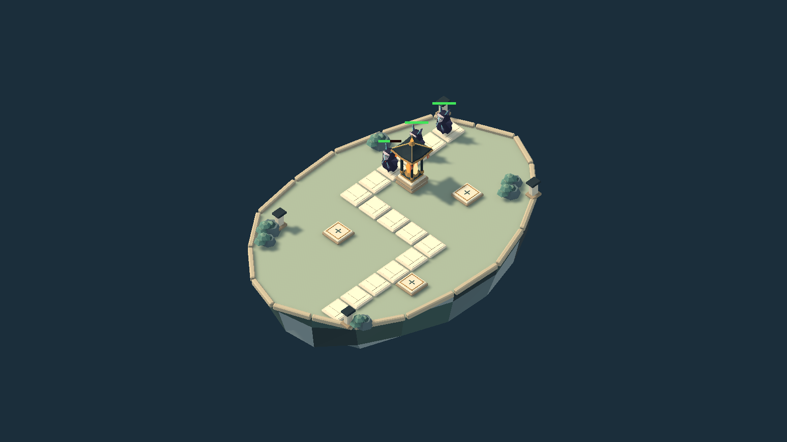 |  |

Оба кадра — **настоящий saved combat, tick 64 / 3 атаки**, с HP и event-driven попаданием. Уменьшенный footprint крыши и более высокий открытый просвет сохраняют четыре опоры, загнутые бронзовые свесы и прежнее огненное ядро. Полная высота/основание фонаря и camera zoom не изменены.

## FLAME — перед / рядом / за

Это **статические Play Mode probes**: противник поставлен для проверки перекрытия, HP 65% задан для просмотра. Они не изображают реальный урон. Положение башни/камеры одинаковое; позиции enemy перечислены в [probe-positions.jsonl](probe-positions.jsonl).

| Позиция | До | После |
|---|---|---|
| Перед | 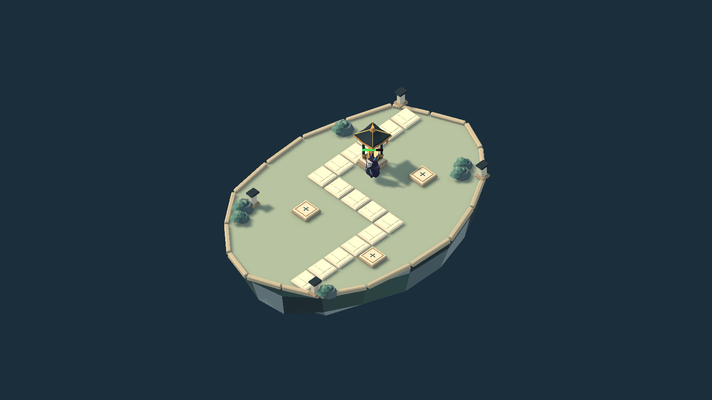 | 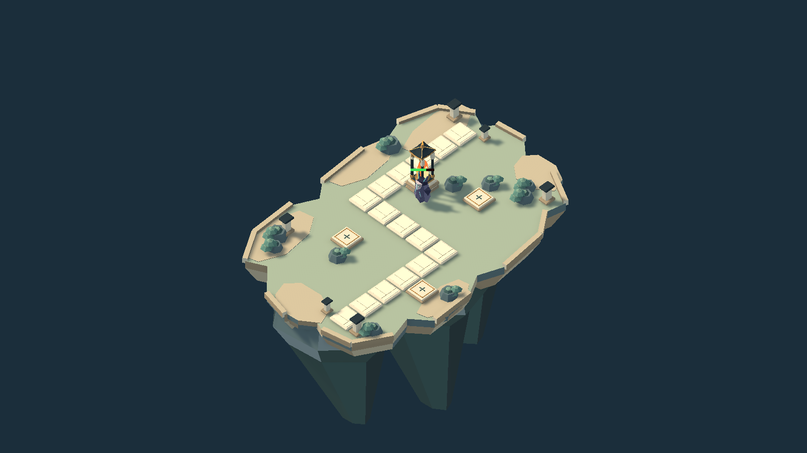 |
| Рядом | 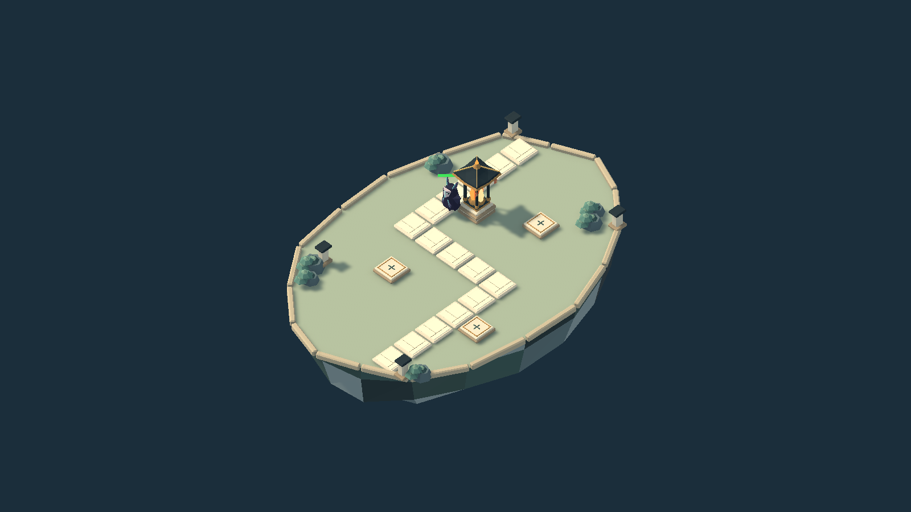 |  |
| Строго за центром | 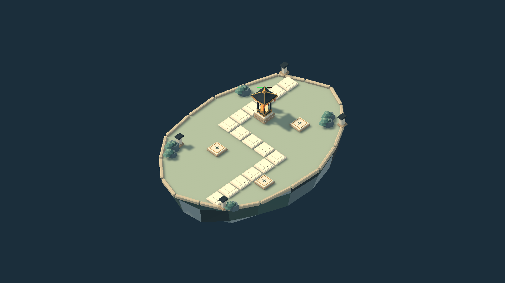 | 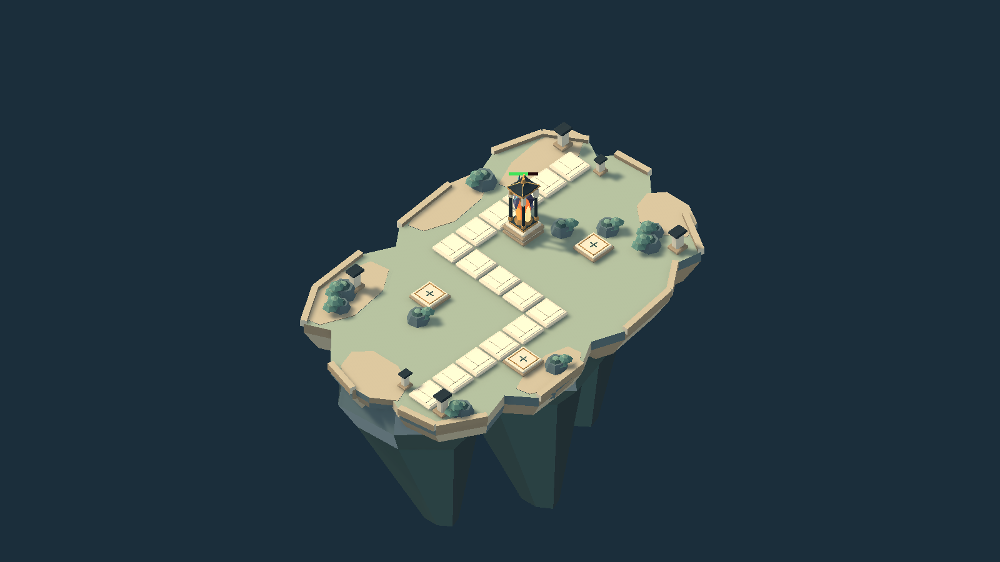 |

Строго за центром сохраняется значительное краткое перекрытие корпуса; HP остаётся виден. Это ограничение явно оставлено для владельческой оценки. Дополнительно [render sweep](occlusion-sweep.json) сравнивает прежнюю/новую геометрию FLAME на 41 точке **того же saved пути** при одинаковом текущем Shade: минимальная доля видимого корпуса 14,6% → 33,6%, средняя 74,0% → 83,7%. Участок с видимостью <20%: 5 samples (около 0,33 s при 1,5 m/s) → 0. Это pixel-mask probe без HP/VFX, не device и не замена просмотра движения; дискретность 0,1 m.

## Shade — игровой масштаб

Более широкие нижние лоскуты и холодные цветовые плоскости отделяют плащ от тёмного окружения. Маска остаётся светлее тела. Габарит/scale, наружный winding и backface culling сохранены. Нижняя неплоская крышка явно триангулирована в `.blend`, чтобы exporter не менял её диагонали.

| Условие | До | После |
|---|---|---|
| Светлый фон, ortho 8.5 | 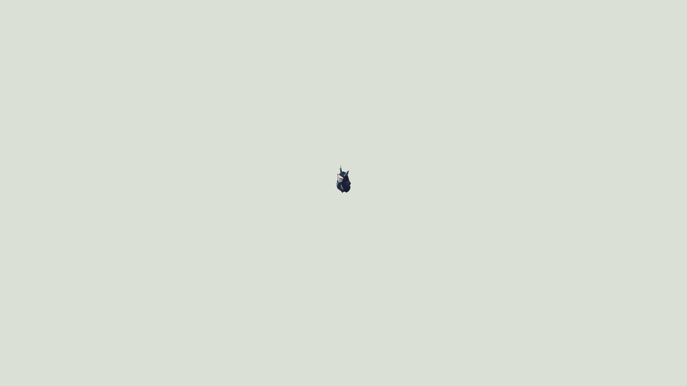 | 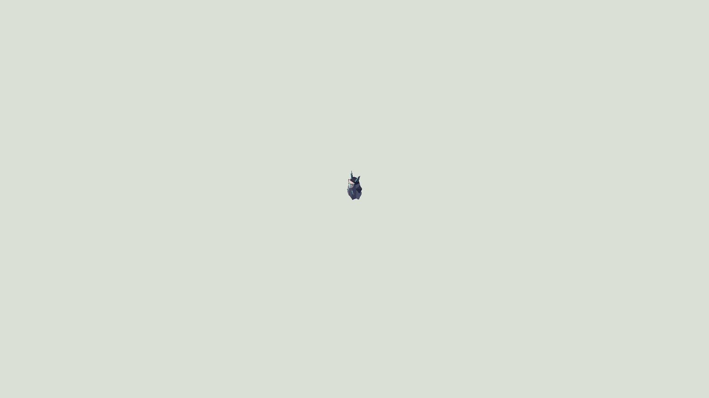 |
| Тёмный фон, ortho 8.5 | 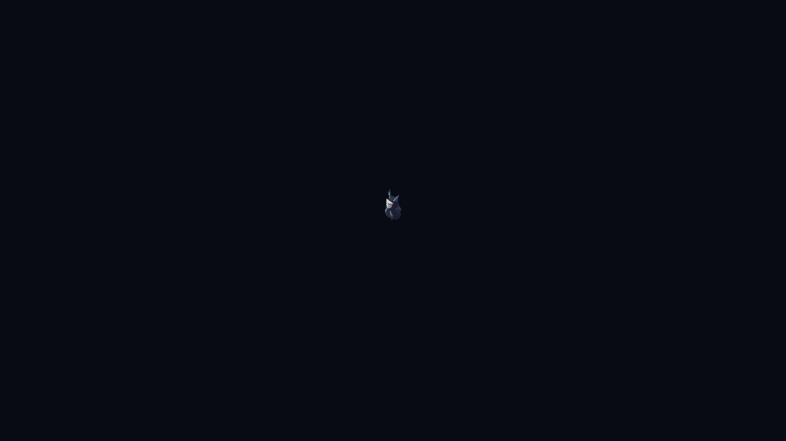 |  |
| Плотная группа, ortho 8.5 | 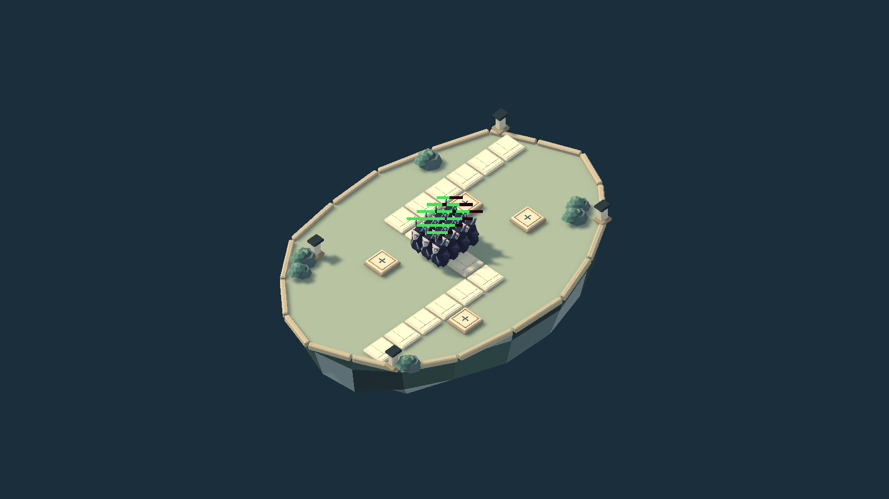 | 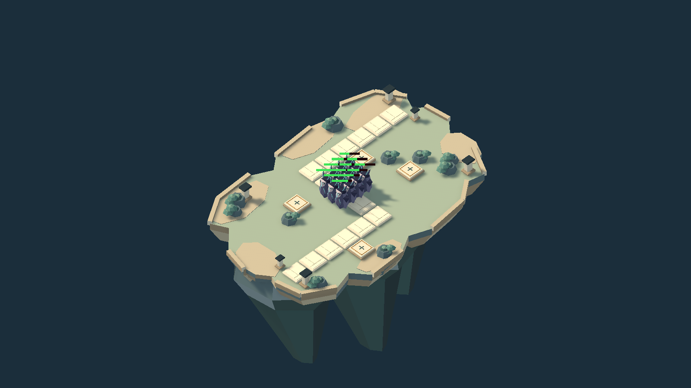 |

Изолированные фоны и плотная группа — статические probes. Группа из 12 instances с интервалом 0,48 m намеренно плотнее saved wave, без изменения gameplay/configs. Оригинальные PNG следует открывать в полном размере; уменьшенные previews таблицы не подходят для оценки iPhone.

## Дополнительные крупные планы

**Не игровой масштаб:** ortho 1.25, только для рассмотрения формы/плоскостей.

| До | После |
|---|---|
| 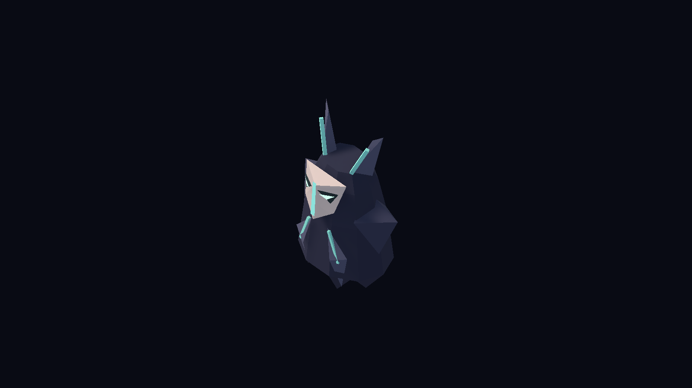 | 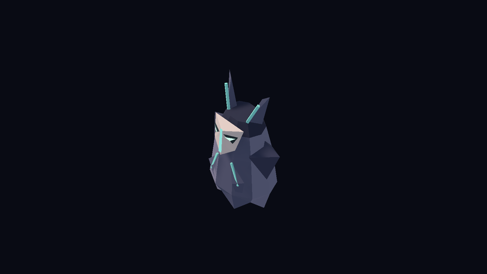 |
| 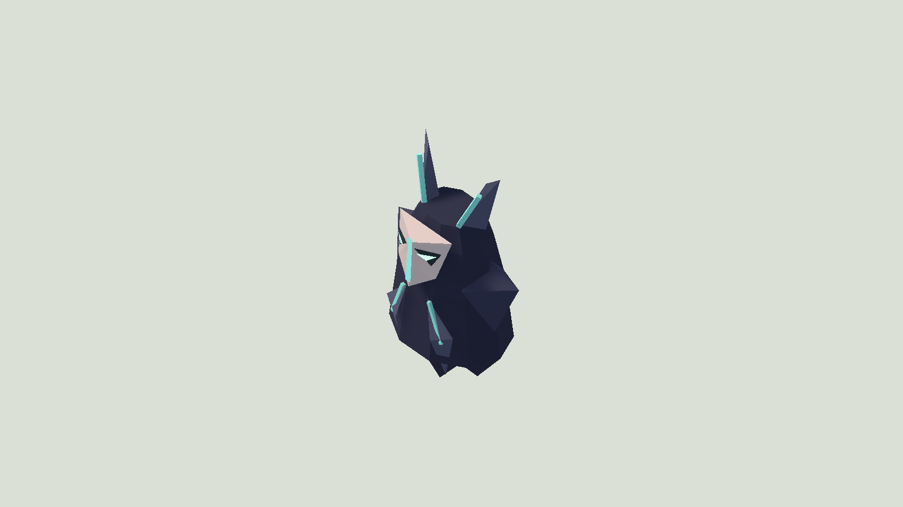 | 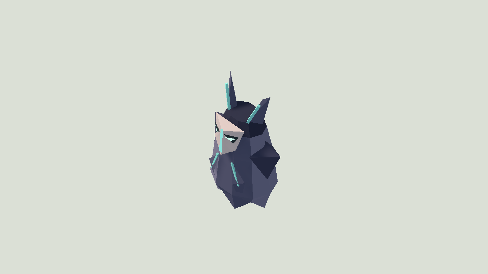 |

## Настоящий Play Mode бой и видео

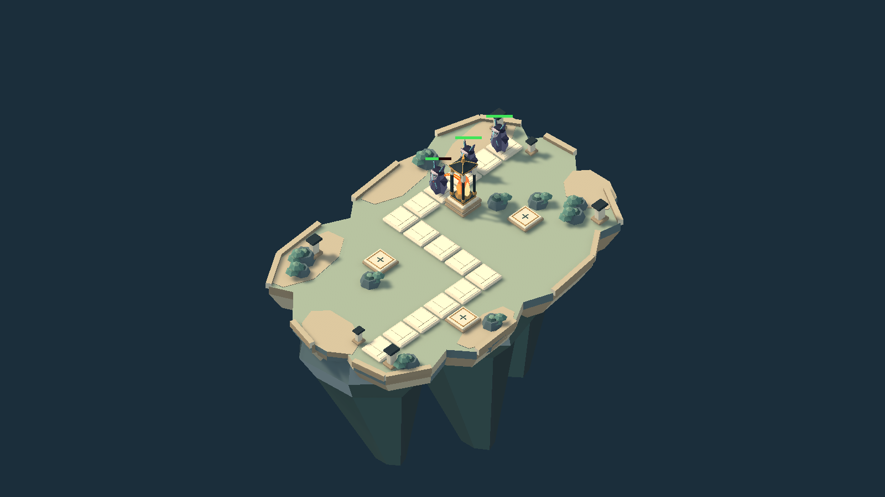

[Видео боя — 8 s, 1280×720 / 30 fps](09-playmode-combat.mp4). **240 кадров реального player loop, tick 0→239, 8 атак**; [frame/tick telemetry](video-capture.json). Запись offline-paced через `Time.captureFramerate`, не измерение realtime FPS. HP/атаки/попадания берутся из существующей saved simulation и `AttackEvent`; probe positions здесь не применяются.

[Независимое техническое review](technical-review.md): открытых Critical/Important/Minor нет; это не художественное approval.

## Статус приёмки

**VERIFIED:** результаты технических gates, source/FBX/Unity round trip, GUID/local IDs/references, negative exporter control, реальные Play Mode captures перечислены в [QA](qa.md).

**NOT VERIFIED / OPEN:** окончательный стиль, чтение на физическом iPhone, touch/safe area, ASTC на устройстве, memory/frame time/thermal, external playtests, баланс/G2 и TestFlight. Владелец просматривает игровой масштаб и видео; closeups и тесты не утверждают стиль. Self-merge/release не выполняются.
