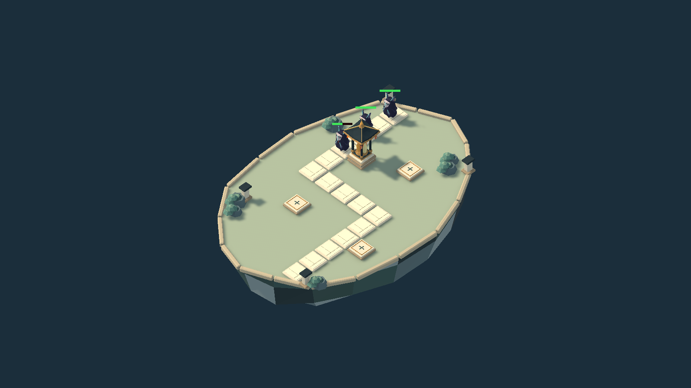

# ART.1 — материалы для визуального и технического review

**Предложение для проверки владельцем. Стиль НЕ утверждён.** Это первый оригинальный визуальный прототип, не готовый арт всей игры и не TestFlight candidate.

## Смотреть в таком порядке

1. [Общий кадр в игровой камере](01-game-camera-overview.png), 1600×900, исходные pose/projection/ortho 8.5. Он показывает реальную величину объектов и свободное пространство карты.
2. [Настоящая FLAME атака](04-flame-attack-playmode.png), та же игровая камера, сохранённый tick с AttackEvent и уменьшением HP; не нарисованный поверх кадра эффект.
3. [FLAME крупно](02-flame-closeup.png) и [Shade крупно](03-shade-closeup.png), 1000×1000. Здесь увеличен только масштаб просмотра при прежнем наклоне камеры; это дополнительные кадры, не доказательство читаемости в игре.
4. Силуэты без окружения при прежнем наклоне: FLAME на [светлом](05-flame-light-background.png) / [тёмном](06-flame-dark-background.png), Shade на [светлом](07-shade-light-background.png) / [тёмном](08-shade-dark-background.png). Сохранены цвет/освещение модели, изменён фон; это value comparison, не чёрная маска.
5. [Короткое видео реального Play Mode](09-playmode-combat.mp4), 1280×720, 180 кадров / 30 fps. Запись использует advancing Unity frames и `Time.captureFramerate=30`, не device realtime benchmark. [Счётчики записи](video-capture.json).

## Художественные решения и наблюдения

- Святилище — тёплый камень, сдержанная нефритовая земля, угольное дерево и бронза. Крупные фаски и цветовые плоскости работают обычным URP/Lit, без нового cel shader framework.
- Путь светлее земли, квадраты площадок обрамлены бронзой и низким знаком socket; декорации собраны у края и не заходят на маршрут. Край острова показывает толщину подвешенного камня. Путь/масштаб взяты из saved TestWave, а не созданы как новая gameplay-карта.
- «Фонарь углей» — ступенчатое основание, открытые четыре опоры, изогнутая крыша, бронзовые рёбра и огненная форма внутри. Тёплый stroke с ярким сердечником связывает ядро с попаданием; нет экрана прозрачного огня, bloom или realtime point lights.
- Shade — разорванный индиговый плащ, асимметричные выступы, двойная корона и светлая направленная маска. Face +Z проверен по импортированной геометрии и поворачивается вдоль пути. Холодные разрывы отделяют его от тёплой архитектуры.
- В основном масштабе читаются массы/маска/HP; мелкие подвески и разрезы глаз теряются. На тёмном фоне нижний край плаща имеет слабый контраст. У близкой к башне цели часть stroke и врага может скрываться крышей: крупные планы не устраняют этот риск. Для итогового решения нужны просмотр владельцем и iPhone-проверка; screenshots не закрывают читаемость/производительность автоматически.

## VERIFIED — Editor

- Unity 6000.3.28f1 (`8f082d2fe476`), URP 17.3.0, Unity CLI 1.0.0, macOS Apple Silicon, active Editor target StandaloneOSX (iOS settings/import override сохранены). Blender 5.3.0 (`02f0899d78e3`), original deterministic geometry.
- **Static 38/38, EditMode 540/540, PlayMode 29/29**, 0 failed/skipped/inconclusive в финальных сохранённых результатах. [Static](static-checks.txt), [EditMode JSON](EditMode.json), [PlayMode JSON](PlayMode.json).
- ART1-01…05: 11 EditMode и 4 PlayMode regression tests проверяют camera/scenario, budgets, pivots/face, imported IDs, реальные movement/HP/AttackEvents, pause и bounded reuse. Общие suites сохраняют экономические/checkpoint/reaction проверки.
- Все восемь сохранённых `.blend` реально открыты, reexported и force-reimported; geometry hashes, GUID/local IDs, `.meta`, prefab/scene hashes и dependencies совпали. [Before](reexport-before.json), [after](reexport-after.json), [результат](reexport.txt).
- Реальные Play Mode camera captures с tick/frame/attack metadata: [capture log](capture-log.jsonl). PNG не являются Blender renders или concept images. [Console audit](console-audit.json) собран после capture.
- `git diff --check` и проверка отсутствия изменений production scenes/configs/Domain/packages выполняются перед PR; точные команды — [QA](qa.md).

## NOT VERIFIED / OPEN

- Решение владельца о направлении, исключительных правах/коммерческой пригодности AI-assisted оригиналов и запуске массового производства.
- Физический iPhone: читаемость в руках, touch/safe area, ASTC качество, overdraw, memory, allocations/frame time, thermal, background/force quit. Ни device PASS, ни 60 fps не заявлены.
- Built iOS player, signing, Xcode, TestFlight/release, CI runner PASS не выполнялись в ART.1.
- G2/external playtests/баланс, P2.3 и оформление оставшихся башен/врагов/UI открыты.

[Asset manifest и происхождение](asset-manifest.md) · [Source/export instructions](../../../ArtSource/Blender/ART1/README.md) · [Спецификация](../../ART1_VISUAL_PROTOTYPE.md).
