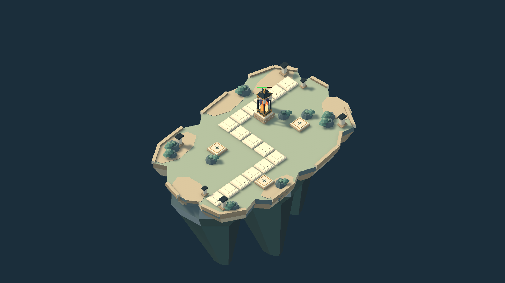
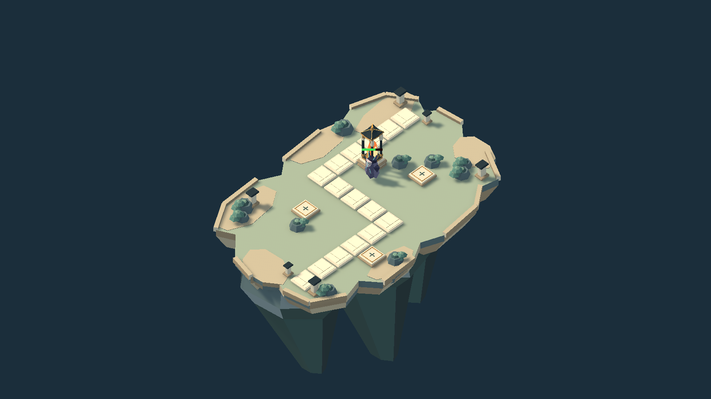
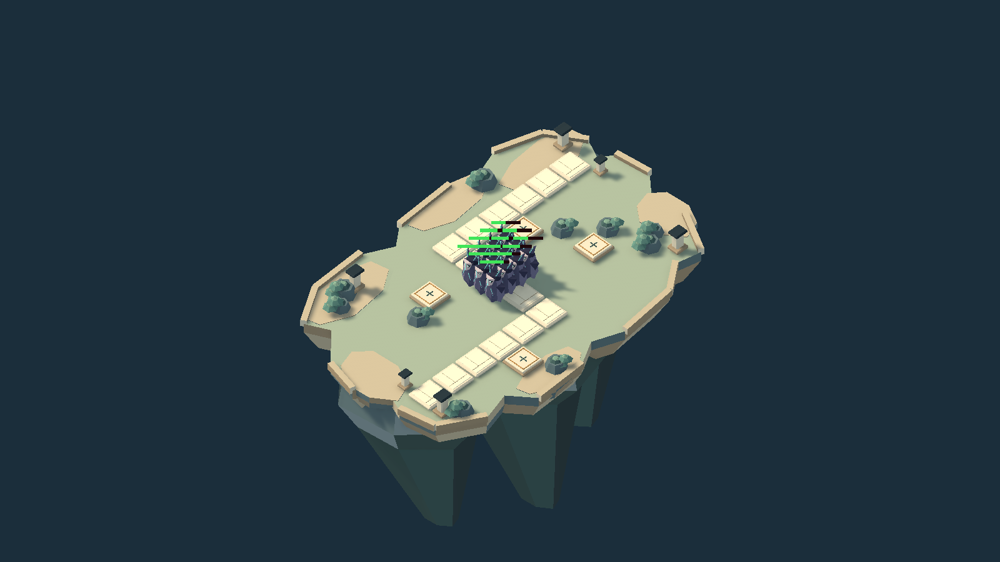
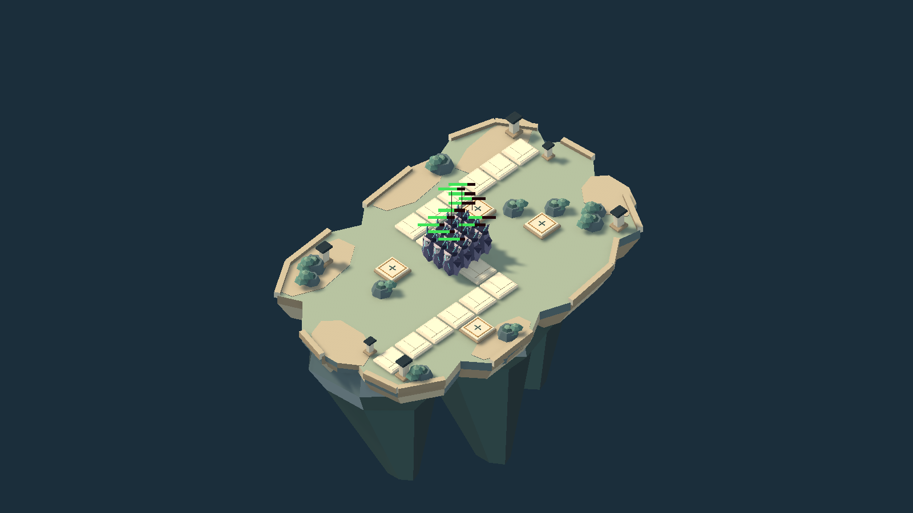
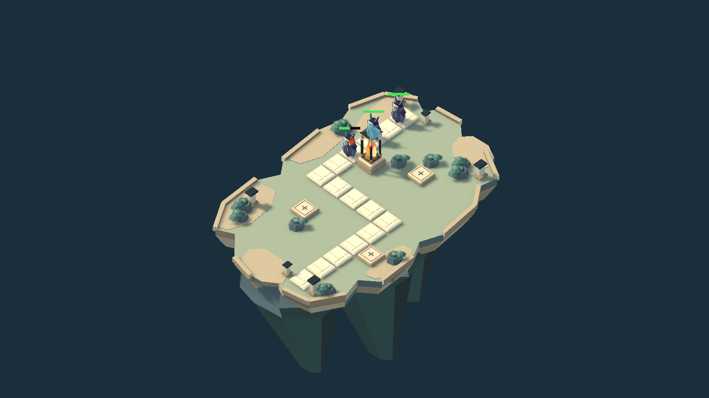
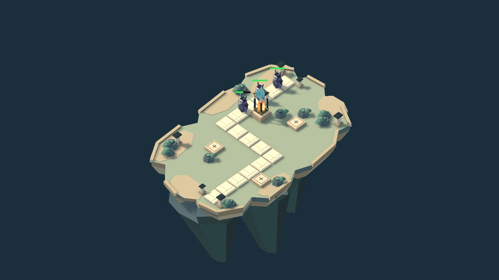

# ART.2a.1 — Shade / HP / огненный импульс

Refs #73, #41, #43. **19.11.2026**, база `7783dd1` (merge #72). Направление острова, палитры и модель фонаря уже выбраны владельцем; это реализация трёх согласованных доработок. [Спецификация и регрессии](../../ART2A1_READABILITY.md).

## Shade за фонарём

Actual Play Mode **static probes**, scale1, прежние camera `(8,11,8)`, rotation `(44.1945,225,0)`, ortho8.5, **1600×900**. Башня `(-2,.16,-1)`, враг .8m строго за центром, HP65% задан вручную. Модель/камера/маршрут не сдвинуты: скрытая часть Shade получает сдержанный холодный pass только на stencil видимой поверхности FLAME. Это визуальный cue, а не геометрическое уменьшение крыши.

| До | После |
|---|---|
|  |  |
|  |  |
|  |  |

[82 diagnostic mask samples](occlusion-mask.json), прежний saved path1…5m/step.1m: минимум body-or-cue coverage33.6%→100%, mean83.7%→100%. Проба использует белую диагностическую tint/чёрную башню и одинаковый threshold100. Геометрическая opaque visibility осталась прежней; эти числа не измеряют контраст реального материала и не заменяют просмотр движения.

## HP плотной группы

Actual Play Mode **synthetic probe**: 12Shade, 4×3, .48m, ratios50/60/70/80%; баланс/spawns не изменены. Пересекающиеся полосы поднимаются по screen Y в стабильном порядке и соединяются тонкой линией с исходным якорем. Fill остаётся той же реальной долей, при исчезновении/переиспользовании view layout сбрасывается. Общий view подключён также в Battle.

| До | После |
|---|---|
|  |  |

Измерено **6→0 overlapping pairs**: [layout disabled, неизменная геометрия](hp-baseline-measurement.json), [after rectangles/ratios/anchor/bar positions](after-hp-layout.json). Это ограниченная фиксированная probe, не гарантия читаемости произвольного числа врагов или маленького экрана.

Дополнительно: [dense+onset](after-dense-impact-0.png), [dense+impact](after-dense-impact-1.png), [dense+decay](after-dense-impact-2.png), [dense+embers](after-dense-impact-3.png). Это **synthetic12/.48m с заданным HP**, поставленные вокруг captured target настоящей атаки на tick64; VFX остаётся реальным event-driven эффектом и advance по2ticks. Это не dense simulation/бой, не fake damage. Масштаб/камера прежние, HP-полосы остаются раздельными при impact. [Console probe](dense-console.json).

## Огненный импульс — реальный бой

[Before — обычный бой, 8s](before-combat.mp4) · [After — обычный бой, 8s](after-combat.mp4). Оба **1280×720/30fps, 240 advancing player-loop frames, tick0→239, 8 AttackEvents**, одна saved simulation/камера/scale. HP/урон/смерть от Domain, удар только от AttackEvent с captured TargetPosition. Запись offline-paced `Time.captureFramerate=30`, не realtime/device FPS. [Before telemetry](before-video-capture.json), [after telemetry](after-video-capture.json), [stills telemetry](capture-log.jsonl).

Новая форма: короткая вспышка ядра, три раздельных сужающихся языка до65ms, компактные языки на цели и четыре быстро гаснущих уголька до220ms. Горячий светлый акцент локален. Stroke/core используют маленький unlit overlay pass (ZTestAlways/ZWriteOff), поэтому impact виден среди opaque Shade без изменения captured world/projected позиции; его высота ниже HP. Старый непрерывный ribbon/core/звезда удалён из showcase; новый hitscan/projectile timing не вводится.

| Начало, tick64 | Impact, tick66 | Затухание, tick69 | Исчез, tick71 |
|---|---|---|---|
|  |  |  |  |

Это реальные simulation frames с deterministic review stepping; видео отдельно доказывает advancing player loop. В QuickTime выполнено воспроизведение before/after на штатной скорости1×; инструмент возвращает дискретные screenshots/состояния. Покадровый просмотр нескольких атак подтверждает разрыв следа/раннее исчезновение trail; субъективный непрерывный motion/художественный approval не выводится из одиночного screenshot. Оба MP4 доступны для полноценного просмотра reviewer/владельцем.

**Scope интеграции:** `FlameStrikeView` — отдельный переиспользуемый presentation класс, сейчас подключён только в ArtReference через prewarmed pool8. Production Battle сохраняет generic AttackBeamView; это не production FLAME-VFX и не закрытие VFX.1/#47. Статусы, damage timing/fire rate/range/Burn, content600/5/schema4/saves/rewards/ability прежние. Окклюзионный pass тоже только для художественного эталона; Battle пока graybox.

[Проверки, команды, VERIFIED и ограничения](validation.md). Исторические ART.1/1.1/2a не переписаны. Physical iPhone art/performance (#43), UI.1, G2, TestFlight/release не проверены и не объявляются готовыми. Self-merge не выполняется.
