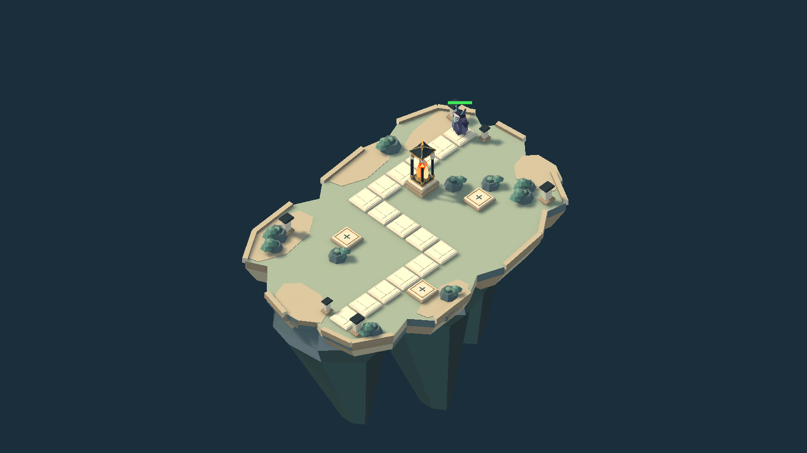
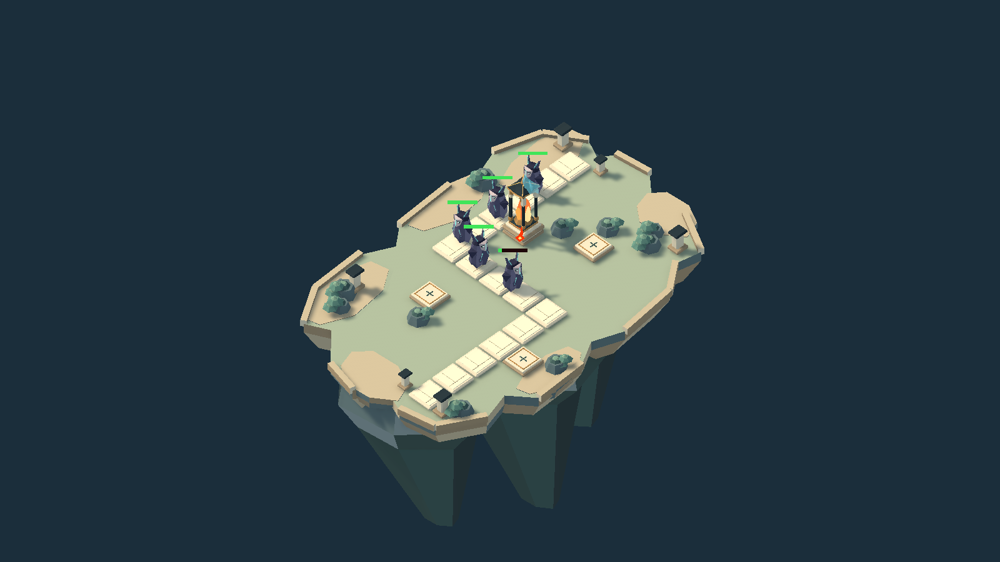
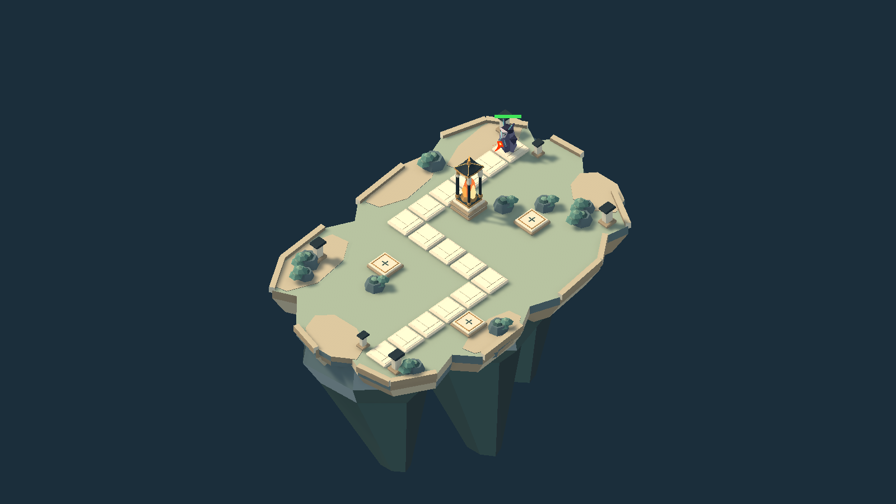
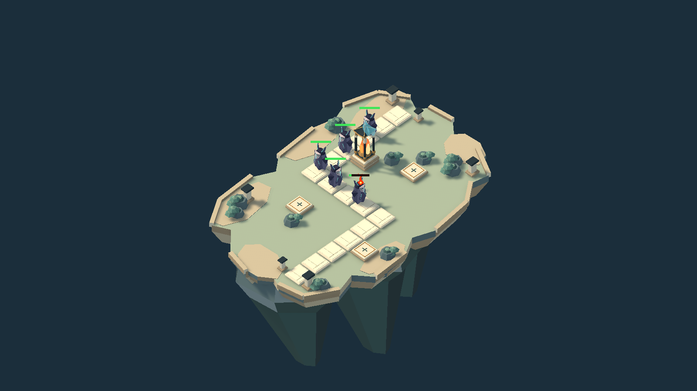
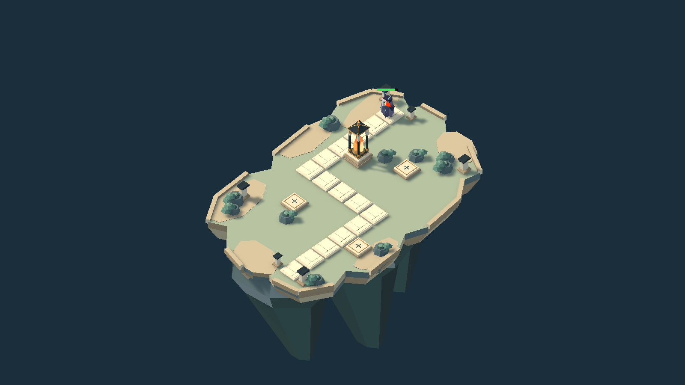
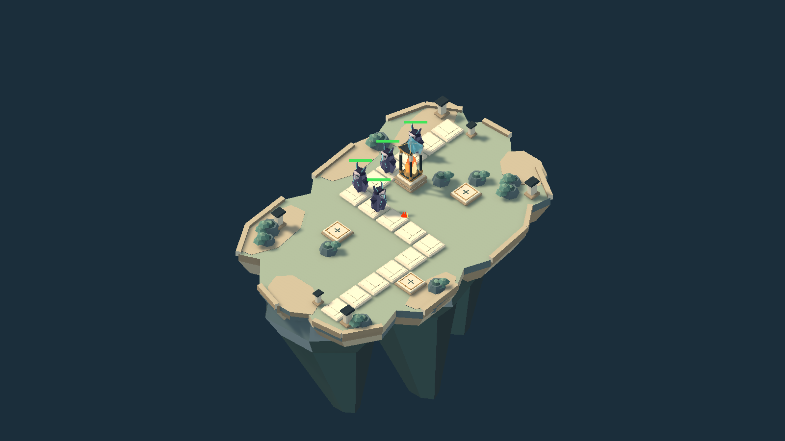
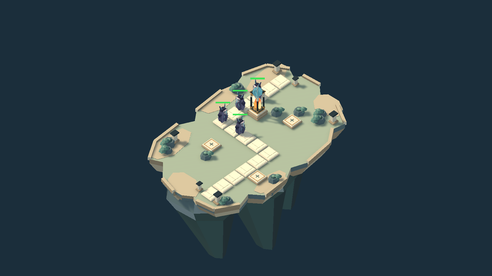
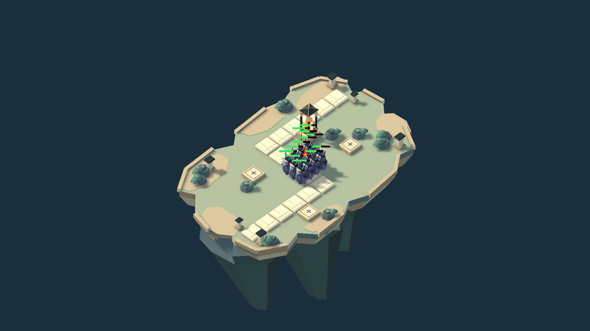
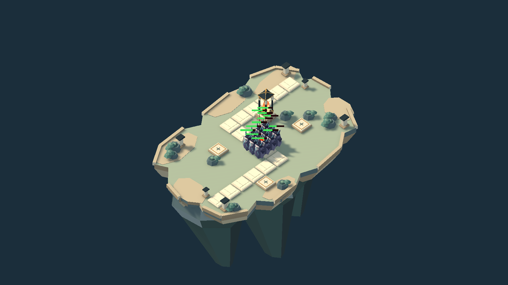

# ART.2a.1 revision 2 — летящий огненный сгусток

Обновление #73 / Draft PR74 от19.11.2026: владелец попросил снаряд вместо луча. Старые streaks ba87f0f не приняты. [Specification/новые регрессии](../../../ART2A1_PROJECTILE.md). Предыдущие [Shade/HP evidence](../README.md), все прежние PNG/MP4/reports/manifests сохранены побайтно; они не являются acceptance нового снаряда.

## Настоящий бой, одинаковая камера и масштаб

[Before — свежая запись прежнего runtime ba87f0f](before-combat.mp4) · [After — летящая головка/короткий хвост](after-combat.mp4).

Оба MP4:1280×720,30fps,8s,240 advancing frames,tick0→239,8настоящихAttackEvents. Камера(8,11,8),rotation(44.1945,225,0),ortho8.5; scale1. Time.captureFramerate30 — offline capture pace, не performance/FPS измерение. [Before clock](before-video-capture.json), [after clock](after-video-capture.json), [каждый after кадр:head/ID/HP/tick](video-frames.jsonl). HP=-1 означает отсутствие ID в данном authoritative/live timeline, не отрицательное здоровье.

Головка — компактные слои пламени с горячим ядром; реально движется6fixedticks/.2s. Рваный хвост не длиннее .48m следует за головкой; он не соединяет башню с целью. Impact начинается только на arrival, затухает5ticks. Общий lifetime11ticks/.367s, прежний saved cooldown30ticks. Нет новых textures/meshes/lights/bloom/packages; source — original C#/параметрическая LineRenderer geometry, существующие авторские materials/shader.

## Что происходит с уроном и движущейся целью

Domain наносит урон и выдаёт AttackEvent в прежний tick. В ArtReference enemy presentation читает кольцо7value-snapshots с задержкой6ticks: position,HP и removal идут по одному authoritative timeline. Снаряд запускается сразу и прилетает в captured position ровно тогда, когда отображается snapshot исходного damage tick. Это локальная visual latency художественного harness, не ballistic physics и не отсрочка gameplay damage. Spawn/Burn/leak feedback тоже задержаны этим timeline; UI/gold/правила Domain не подделываются. Production Battle этого delay не получает.

На lethal launch враг уже удалён из Domain и награда начислена, но живой visual snapshot остаётся до arrival; на arrival он удаляется и появляется локальный impact. На nonlethal arrival виден точный post-hit HP/position, полученный из snapshot. Проекция/модели/маршрут/spawn schedule не подменены. Полёт хранит TargetEnemyId/captured position, не Transform; stable-ID view slots не переадресуют hit новому врагу.

## Actual Play Mode phase stills

1600×900, та же игровая камера. Это public simulation с deterministic review stepping, отдельно от advancing video. [Полная telemetry](phase-telemetry.jsonl).

| Фаза | Nonlethal | Lethal |
|---|---|---|
| Вылет |  |  |
| Половина полёта |  |  |
| Перед попаданием |  |  |
| Arrival / impact |  |  |
| Затухание |  |  |
| Expired |  |  |

## Dense — явно synthetic

12Shade/.48m, заданные HP50/60/70/80%, placement вокруг captured target настоящей lethal атаки. Полёт/impact идут по настоящему AttackEvent, но это **не dense simulation/бой**. Камера/scale прежние. В ArtReference HP priority3030 выше VFX3020: цвет/ratio/layout сохраняются, короткий эффект не красит полосы.

| Вылет | Mid-flight | Pre-impact |
|---|---|---|
|  |  |  |

| Impact | Decay | Expired |
|---|---|---|
|  |  |  |

Первый independent review нашёл P2: overlay head/tail заменял HP pixels. [RED capture](hp-overlap-red.png) сохранён отдельно, не PASS. Приоритет HP исправлен локально в ArtReference двумя prewarmed shared material copies; common EnemyHealthBarView/Battle не менялись. Render regression ставит HP поверх реального moving head и сравнивает135fill/background pixels со снарядом/без него.

## Границы приёмки

[Проверки/команды](validation.md) · [Независимое review](review.md) · [Чистая доставка](delivery-audit.md).

VERIFIED и NOT VERIFIED разделены в validation. Просмотр отдельных фаз/декодирование/telemetry не равны непрерывному human normal-speed motion approval. PR74 остаётся Draft/Refs73 до обновлённого acceptance. HP/occlusion сохранены; новый снаряд пока только ArtReference, production Battle generic beams прежние. #43 physical iPhone/readability/performance и #47 production VFX/G2/release не закрываются; self-merge/TestFlight не выполняются.
