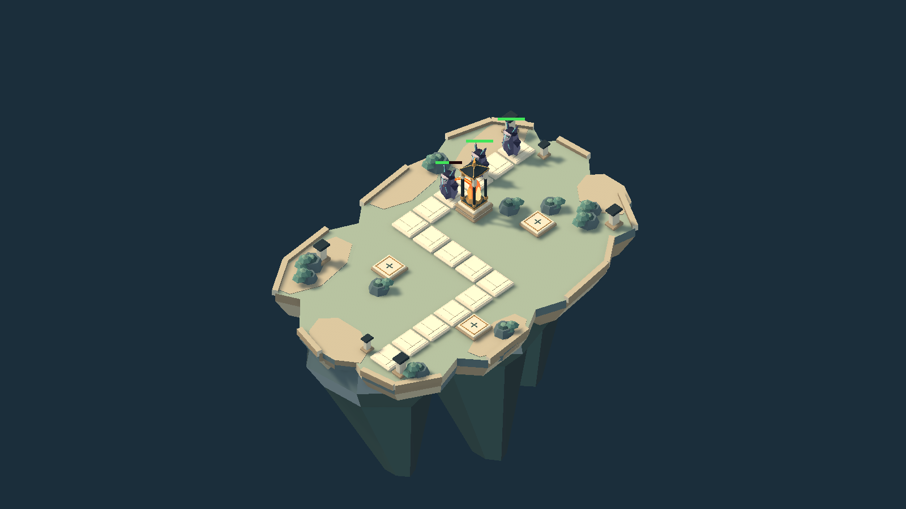
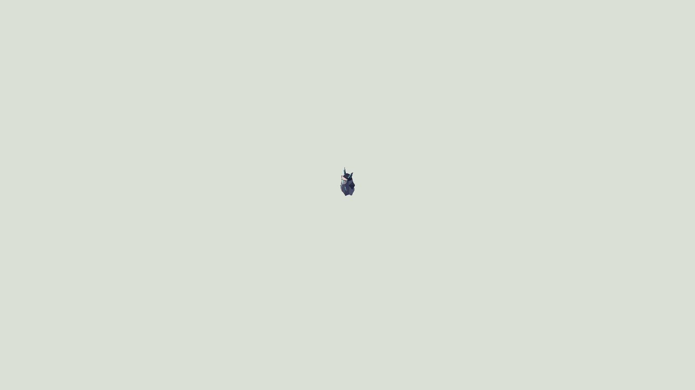
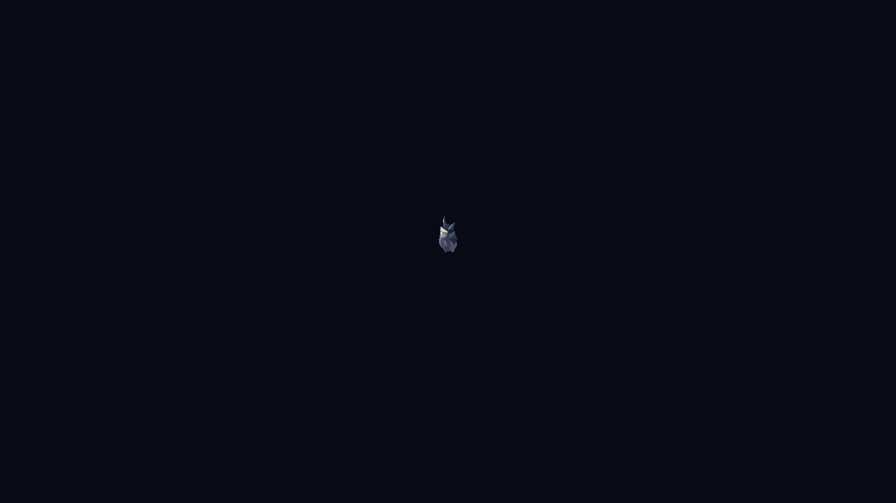
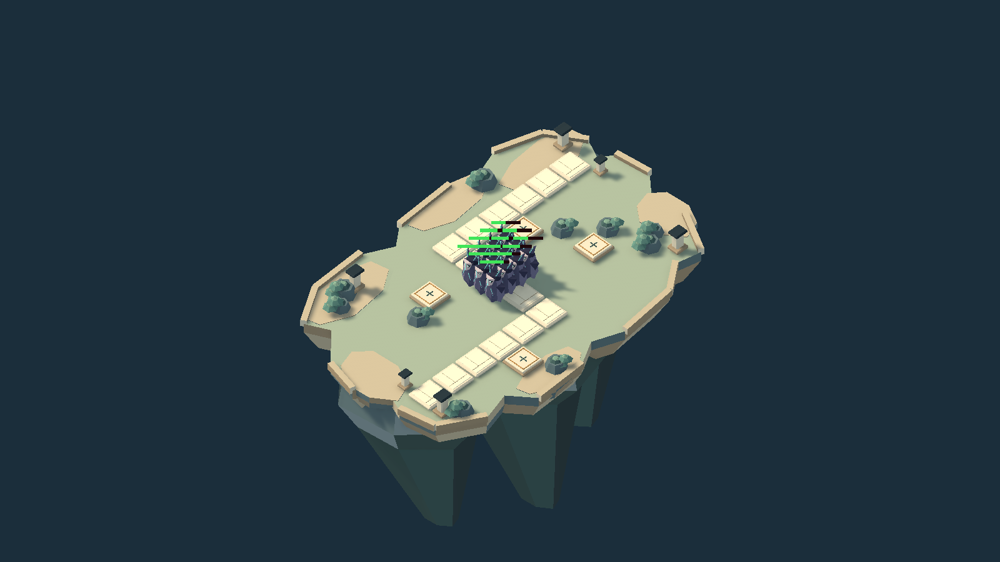
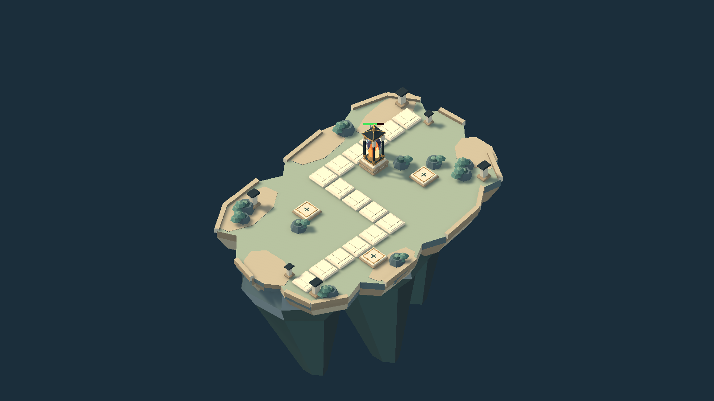

# ART.2a — предлагаемый художественный эталон

**Ожидает решения владельца · Refs #41 · 19.11.2026.** Предлагается принять направление ART.1.1: гранёная диорама парящего святилища, открытый FLAME «Фонарь углей», холодный Shade со светлой маской и короткий огненный удар. Технические merge #24/#25 стиль не утверждают.

## Пять ключевых кадров

Это **исторические реальные Unity Play Mode captures ART.1.1, 16–17.11.2026**, source head [`4b14e21`](https://github.com/AlexeyKravtsov95/Veilward/commit/4b14e21), merge #25 `4ff11b5`. Сравнение с main `0028981` подтвердило побайтовую неизменность источников и визуальных входов: `.blend`, FBX/`.meta`, prefabs, материалы/палитра, ArtReference, camera/showcase/capture scripts и render settings. [SHA256 manifest](provenance.json), [проверки и точные границы](validation.md). Новых captures и ретуши нет.

Все пять PNG — **1600×900**, camera `(8,11,8)`, rotation `(44.1945,225,0)`, orthographic **8.5**; FLAME world `(-2,.16,-1)`, scale **1**; 1 unit = 1 m. FLAME height **2.285 m**, основание **.94×.94 m**; Shade **.84×1.35×.5626 m**, scale 1. Открывайте оригиналы в полном размере: встроенное уменьшение страницы не имитирует iPhone. [Capture telemetry](../ART.1.1/capture-log.jsonl).

**1. Общий игровой ракурс и настоящий бой.** Tick 64, три атаки; HP и короткий удар FLAME получены из public simulation/AttackEvent. Светлая дорога отделена от приглушённого окружения, свободные площадки различимы, огонь задаёт главный тёплый акцент. Это один кадр, также сохранённый в ART.1.1 как `after-02-combat.png`, а не два разных доказательства.

[Реальное combat video, 8 s / 1280×720](../ART.1.1/09-playmode-combat.mp4): **240 advancing frames, tick 0→239, 8 атак**. [Telemetry](../ART.1.1/video-capture.json), [Console audit: 0 errors / 0 warnings](../ART.1.1/console-audit.json). Запись offline-paced через `Time.captureFramerate=30`; это не realtime FPS. Исторический бой проверяет вид движения/удара, не является новым прогоном текущей mission v2, способности, босса или reactions.

**2. Shade на светлом фоне, игровой масштаб.** Изолированный static Play Mode probe, окружение/HP скрыты. Тёмный плащ и раздвоенная корона дают силуэт; светлая маска обозначает направление. Это тест контраста, не кадр настоящего боя.

**3. Shade на тёмном фоне, игровой масштаб.** Такой же static probe: холодные плоскости подола отделяют корпус от фона, маска ярче тела. Мелкие швы не должны становиться основным способом распознавания.

**4. Плотная группа.** Static Play Mode probe: 12 экземпляров через .48 m, намеренно плотнее saved wave; HP выставлены для просмотра. Контур группы различим, отдельные корпуса и HP-полосы перекрываются. Индивидуальная читаемость в такой плотности **не подтверждена**.

**5. Shade строго за FLAME.** Static Play Mode occlusion probe, HP **65% задан вручную**. Крыша/опоры значительно скрывают корпус; надкрышевая HP-полоса остаётся видна. Это оставшееся ограничение для явного решения владельца, не утверждение полной читаемости.

[Другие ракурсы перед/рядом/за и сравнение до/после](../ART.1.1/README.md). Исторический [pixel-mask sweep](../ART.1.1/occlusion-sweep.json) дал минимум видимого корпуса **33.6%** на 41 sampled позиции пути; он не покрывает все сочетания позиции/камеры и не отменяет кадр 5. [Closeups Shade](../ART.1.1/README.md#дополнительные-крупные-планы) используют ortho **1.25** — только рассмотрение формы, не игровой масштаб.

## Что предлагается закрепить

| Область | Предлагаемый эталон |
|---|---|
| Палитра/поверхности | Тёплый камень `#EADCC0/#C8B798`, приглушённый нефрит `#628E80/#80A28C`, угольное дерево `#192C33`, бронза `#BC8C50`. Крупные матовые плоскости/фаски, мало мелкого шума. Цвета — swatches исходной палитры, не измеренные экранные pixels. |
| FLAME | Четыре открытые опоры, уменьшенная загнутая крыша, бронзовые края и видимый кораллово-золотой огонь `#FA7E3E/#FFE7A0`. Вертикальный силуэт фонаря узнаётся до деталей. |
| Shade | Разорванный холодный плащ `#24253F/#51516F`, раздвоенная корона, светлая маска и холодный разрез `#8CE2DB/#D2FFF0`; маска — главный акцент врага. |
| Иерархия | Environment остаётся спокойнее дороги/площадок; башня читается по силуэту и ядру; маска/HP врага сохраняют приоритет во время попадания; VFX — короткий локальный акцент по цели. Окклюзия кадра 5 и HP overlap кадра 4 остаются открытыми. |
| Материалы/VFX | Существующие URP/Lit + opaque URP/Unlit, shared palette 128×64, без bloom/добавочных lights. Короткий огненный stroke/core берётся из AttackEvent. Steam/Storm/ability/boss VFX этим пакетом не утверждаются. |
| UI — только направление | Приглушённые индиго/угольные панели, светлый читаемый текст, бронза для рамок и локальный цвет стихии для действия; распознавание также по форме/значку. Это предложение будущему UI.1, готового UI в кадрах нет; layout/font/touch/safe area требуют отдельной работы. |

[Asset counts, происхождение и ограничения](../ART.1.1/asset-manifest.md), [редактируемые Blender sources и export preset](../../../ArtSource/Blender/ART1/README.md), [ART_PIPELINE](../../ART_PIPELINE.md). Обычные модели ≤5000 triangles / ≤2 slots; это сохранённые geometry budgets, не измеренная производительность iPhone.

## Решение владельца

Для записи решения укажите **«принять» / «принять с перечисленными правками» / «переработать»** и номера кадров:

1. Остров, палитра/материалы и игровой масштаб кадра 1.
2. Силуэт открытого фонаря FLAME и короткий огненный stroke в кадре 1/видео.
3. Shade/маска/подол на светлом и тёмном фоне (2–3); допустимость плотной группы и HP overlap (4).
4. Допустимость текущего перекрытия Shade крышей/опорами (5), либо необходимость правки до device proof.
5. Соответствие предложенного UI направления выбранному стилю; это не приёмка готового интерфейса.

**Решение ещё не получено.** После ответа фиксируются выбранные кадры и точный список правок. #41 остаётся open до выполнения её acceptance; следующий #43 требует отдельного real-iPhone readability/performance evidence до массового производства.

**VERIFIED:** целостность/происхождение исторических визуальных материалов, доступность пакета из Git, static/diff gates — [validation](validation.md).

**NOT VERIFIED / BLOCKED:** художественное утверждение владельца, ART.2b на физическом iPhone, читаемость/окклюзия в built player, frame time/memory/thermal, готовый UI и остальной арт MVP. QA.1 graybox smoke не заменяет ART.2b. Self-merge/release/TestFlight не выполнялись.
