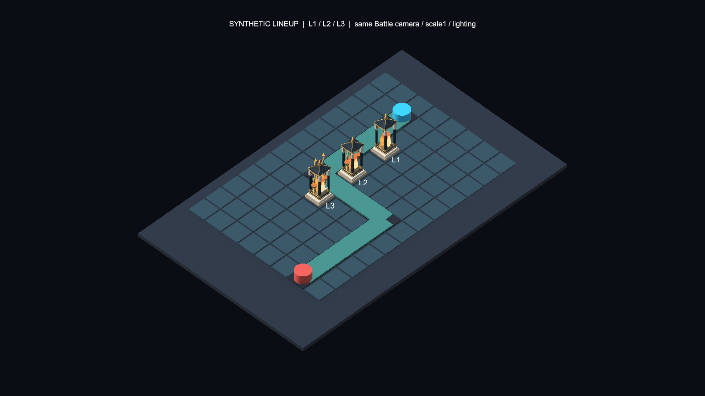

# ART.3a — FLAME L1–L3 / частичный пакет #76

**Draft / Refs #76, Refs #44.** Модели и Battle binding проверены в Editor. Physical iPhone acceptance и performance не выполнены: paired iPhone16Pro/iOS27.0.1 имеет `tunnelState=unavailable`, DDI недоступен. Это не закрытие #76/#44 и не художественное approval владельца.



- [Scope и regression specification](../../ART3A_FLAME_LEVELS.md), [source/export/provenance](../../../ArtSource/Blender/ART3/README.md).
- Одинаковая позиция/камера/свет/scale1: [L1](playmode/single-L1.png), [L2](playmode/single-L2.png), [L3](playmode/single-L3.png). Это подписанные synthetic model probes, не купленные одновременно уровни.
- Натуральные public commands с реальными бюджетами: [L1](playmode/01-natural-L1.png), [бой / generic beam](playmode/02-natural-combat-generic-beam.png), [L2](playmode/03-natural-L2.png), [L3](playmode/04-natural-L3.png), [Combat перед rollback](playmode/05-natural-L3-interrupted-combat.png), [после Sell](playmode/06-natural-sold-no-roots.png). Ускорен только test clock; [trace](reports/natural-trace.txt), [неизменённый заработанный checkpoint](reports/natural-L3-checkpoint.json).
- [Inspect/MAX/range](playmode/inspect-L3.png), [build preview без покупки](playmode/build-preview.png).
- Behind/HP .6, synthetic: [L1](playmode/occlusion-L1-behind.png), [L2](playmode/occlusion-L2-behind.png), [L3](playmode/occlusion-L3-behind.png). Соответствующие front/side PNG входят в manifest.
- Настоящий advancing Battle.Update из этого L3 checkpoint: [начало](playmode/motion-00.png), [бой](playmode/motion-08.png), [generic beam](playmode/motion-10.png), [конец](playmode/motion-11.png), [12-frame telemetry](playmode/motion-telemetry.txt). 7.71s, tick2590→2822, kill41→42. Редкие кадры не подтверждают полную плавность и не являются FPS measurement или видео.
- [Результаты/ограничения](validation.md), [команды](commands.md), [независимый review](review.md), [manifest](manifest.json).

Из чистого checkout:

```sh
PYTHONDONTWRITEBYTECODE=1 python3 Docs/review/ART.3a/verify_delivery.py
```

Verifier проверяет exact tested source, сохранность baseline/history, tracked hashes/inventory, непустые полные1123/75 suites и реальный трёхуровневый roundtrip. Он не запускает Unity и не объявляет device PASS. Generic attack beam остаётся до #47; принятый projectile в ArtReference не переносился в production вместе с model integration.
