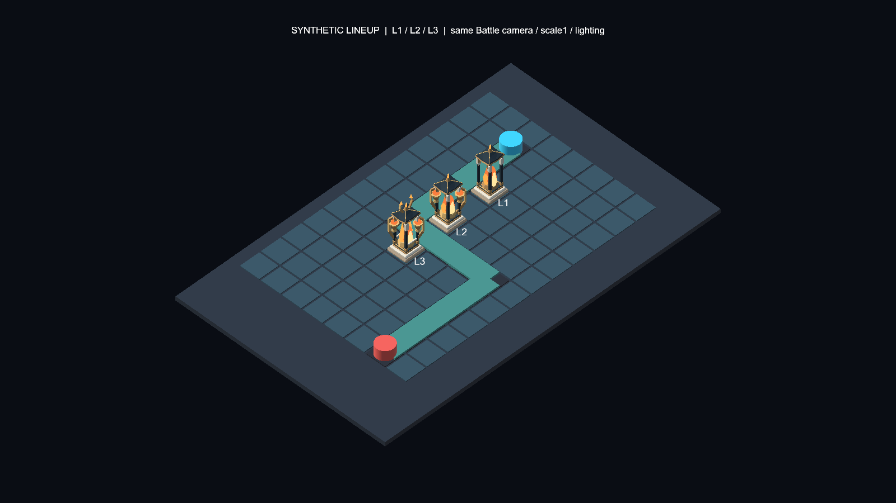
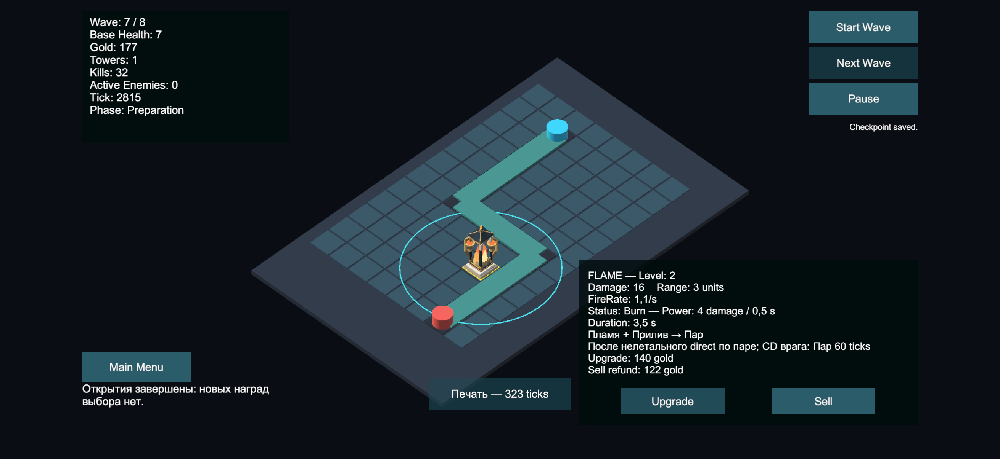
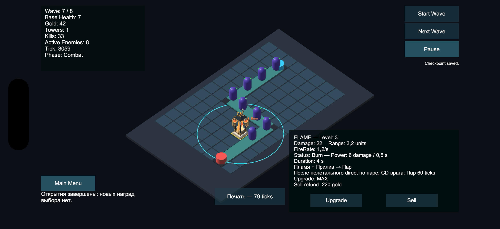

# ART.3a R2 — новый L2 и device proof / PR77

L2 теперь читается по крупной открытой бронзовой раме и двум боковым чашам; L3 сохраняет следующий шаг венца/ядра. ART1 и L1 bytes сохранены. Tested source `f890a51c9df2f506a46bbe3f10f5f2607368e319`, оба native exports — `ff6a333940e707366bdf6b8df42a12f311d3e143`.

**VERIFIED:** static38/38, EditMode1126/1126, PlayMode77/77, compile0errors, roundtrip3/3; imported1256/1580/1736tri/2slots. Native production77: earned checkpoint replay, реальные UI Upgrade L1→L2→L3, advancing wave7, HP/Burn/Inspect, rollback и Sell/Continue. Отдельный art78: matched ART1/L1/L2/L3, четыре fresh completed runs по3×30s после5s warmup; same iPhone/camera/quality/dense12, ScreenSharingOFF, raw timing/Unity memory и отдельный numeric native memory capture.

[Непрерывное native видео Upgrade→бой](device/upgrade-native.mp4) заканчивается закономерным Defeat одиночной L3. [Второе native видео](device/combat-rollback-native.mp4) — отдельно подготовленный replay earned L3 checkpoint, короткий actual бой до8врагов/Burn/Inspect, Pause→Continue rollback→Sell220→Gold257. Оба1×, без splices; setup/trim/ограничения раскрыты.

[Полная валидация и границы](validation.md) · [Matched measurements](performance.md) · [Команды](commands.md) · [Независимое review](review.md) · [Raw reports](reports/) · [Native flow](device/phone-flow.json) · [Manifest](manifest.json).

**NOT VERIFIED / отдельные gates:** художественное approval владельцем/повторная приёмка PR, вся #44 ART direction, production thermal/overdraw/широкая device QA и human multi-touch. Generic Battle beam остаётся до#47. Renderer/slot counts — structural observations; unavailable counters не называются0costPASS. PR77 остаётся Draft/Refs76/44, issues открыты; self-merge/release/TestFlight не выполняются.

Проверка из чистого checkout: `PYTHONDONTWRITEBYTECODE=1 python3 Docs/review/ART.3a/verify_delivery.py` (нужен ffprobe). Она сверяет точные source/build inputs, прежние evidence, artifact inventory/hashes, positive full suites, roundtrip, native checkpoint arithmetic, raw matched summaries и video PTS. Она read-only и не заменяет реальные Unity/device runs. Исторический R1 — уровнем выше; его build76/triangle counts и transfer blocker не описывают текущую R2.
