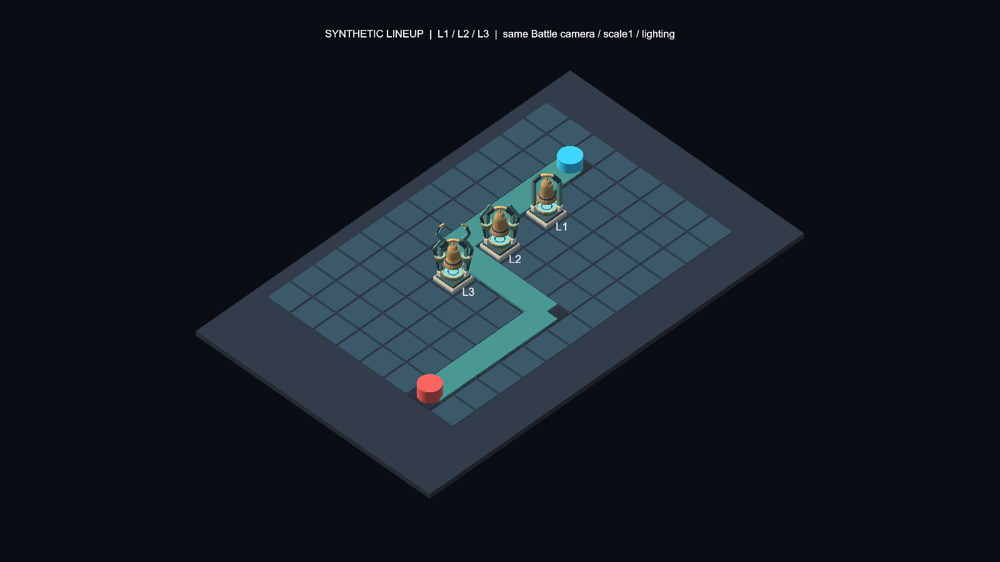
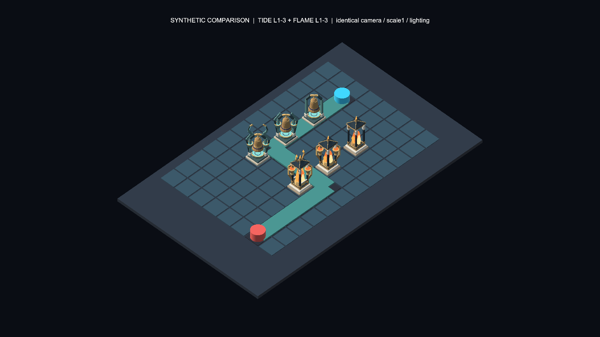

# ART.3b — TIDE «Колокол прилива» L1–L3

Вторая из шести production линеек. Вход: main57cae61/merge77, [spec/regressions](../../ART3B_TIDE_LEVELS.md). FLAME/ART1 и их исторические proofs сохранены. Это Editor/source/Battle пакет для review владельцем; родитель44 и finalVFX47 отдельно.

**VERIFIED:** original editable .blend→FBX→Unity TIDE, один shared binding owner с FLAME, targeted18/18Edit+2/2Play; actual all3 roundtrip geometry/UV/normals/materials/GUID/localIDs/refs; реальные Play Mode кадры и continuous real-time Editor clip. Полные финальные suites и delivery audit — [validation](validation.md), независимые замечания/исправления — [review](review.md).

**Device Deferred to prerelease QA #53/#54/#55** по решению владельца20.11.2026. Эти кадры/видео не являются iPhone readability/performance/touch/thermal PASS. Новые device binaries/native recordings/matched benchmarks не создавались. Без self-merge/release/TestFlight.

## Просмотр при исходной Battle camera

[L1](playmode/single-L1.png) · [L2](playmode/single-L2.png) · [L3](playmode/single-L3.png) — одинаковые camera/scale1/lighting. Ниже synthetic lineup и comparison: назначенное расположение presentation objects, без изменения live Domain/DTO. L1 — открытый bell над чашей, L2 — крупные боковые чаши/усиленная рама, L3 — высокие разомкнутые рога. TIDE не использует FLAME geometry; общая palette намеренно связывает семейства.

## Законный Battle lifecycle

[NaturalL1](playmode/01-natural-TIDE-L1.png) · [L2](playmode/02-natural-TIDE-L2.png) · [L3](playmode/03-natural-TIDE-L3.png) · [combat](playmode/04-natural-TIDE-interrupted-combat.png) · [Sell](playmode/05-natural-sold-no-model-roots.png). Это production NewGame и public commands с явно подписанным ускоренным test clock первых шести волн, не realtime performance test. Затем настоящая продажа части армии оплачивает TIDE Place/Upgrade. Не редактировались live Gold/HP/DTO. [Trace](reports/natural-trace.txt), [L1/L2/L3 checkpoints](reports/natural-L1-checkpoint.json), [binding trace](reports/binding-trace.txt).

[Короткое Editor video](editor-flow.mp4): реальное время, 1600×900,204composited GameView frames/~20.95s, переменные интервалы около0.1s. Побайтный replay именно заработанного выше L1 checkpoint, обычный MainMenu Continue, UI Upgrade L1→L2→L3, advancing Combat/HP/Wet+enemy Inspect, Menu Continue rollback, Sell confirmation/cleanup. [Origin/restore/readback](reports/video-checkpoint-origin.json), [frame/tick telemetry](reports/video-frames.txt), [PTS/encoding proof](reports/video-proof.json). Это новый replay ранее earned состояния, не ещё один fresh run1…6. Нет склеек, изменения скорости или перерисовки игровых pixels; PNG picks — точные source кадры.

[L1](playmode/video-L1.png) · [L2/Upgrade/range](playmode/video-L2.png) · [L3/MAX](playmode/video-L3.png) · [actual Wet/Inspect](playmode/video-Wet-inspect.png) · [rollback](playmode/video-rollback.png) · [sold](playmode/video-sold.png).

Каталог/preview проверяются production UI suites и отдельным actual Play Mode кадром: [TIDE catalog + build preview](playmode/catalog-build-preview.png). Это replay earned состояния; выбор пустой клетки и типа не выполняет покупку.

## Synthetic readability probes

Каждый уровень: [L1 front](playmode/occlusion-L1-front.png)/[side](playmode/occlusion-L1-side.png)/[behind](playmode/occlusion-L1-behind.png), [L2 front](playmode/occlusion-L2-front.png)/[side](playmode/occlusion-L2-side.png)/[behind](playmode/occlusion-L2-behind.png), [L3 front](playmode/occlusion-L3-front.png)/[side](playmode/occlusion-L3-side.png)/[behind](playmode/occlusion-L3-behind.png). [Dense12](playmode/occlusion-dense.png). Позиции врагов и HP назначены вручную, Wet badge копирует настоящий read-only Wet snapshot отдельной simulation из earnedL3. Main live Domain/DTO не изменяется. Это controlled synthetic probes в Play Mode, не естественная волна и не benchmark.

Reuse прежнего stencil mask/body/HP cue сохраняет читаемость за моделью. На prefab два renderers (model+mask), structural4material submissions; исходный mesh2slots. Это не measured draw calls и не заявление нулевой GPU стоимости. Current generic beam и graybox enemies сохраняются до47/46. Камера/освещение/quality: [settings](playmode/settings.json).
