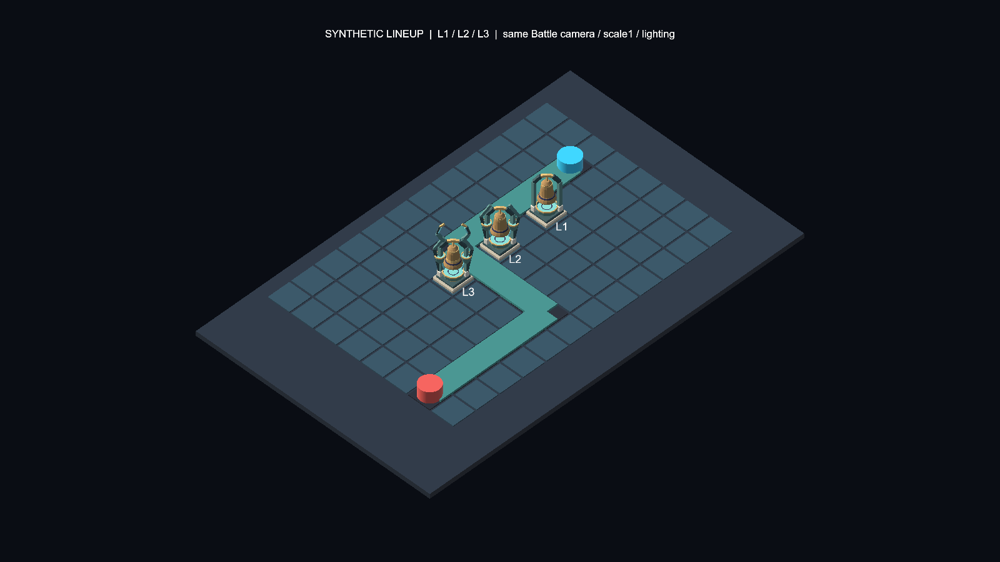

# ART.3b R2 — TIDE L1–L3 / #78

Актуальный пакет после независимого R1 review. [Исторический R1](../README.md) сохранён: его HP behind и дублированный video-L3 не выдаются за исправленный результат. SourceSHA **696dc8ae3cc7799bea586c57d44749163300b06c**; production HP delta8a3bce0. Последующие source изменения — только надёжный Editor capture driver.

Выполнены original TIDE Bell L1–L3, совместный single-owner FLAME/TIDE binding, source/import/regression checks и реальные новые Editor кадры/видео. HP anchor production Shade поднят с localY.85 до2.0, чтобы полоса находилась над проекцией головы и между неперекрывающимися status slots. Новых материалов, passes, моделей или Domain изменений нет. Финальные полные gates и delivery audit записываются в [validation](validation.md), scoped re-review — [review](review.md).

**Device Deferred to prerelease QA #53/#54/#55**, решение владельца20.11.2026. Editor proof не является iPhone performance/readability PASS. Без self-merge/release/TestFlight; родитель44 и остальные семейства отдельно.

## Модели при исходной Battle camera

[L1](playmode/single-L1.png) · [L2](playmode/single-L2.png) · [L3](playmode/single-L3.png), [lineup](playmode/lineup.png) и [сравнение с FLAME](playmode/tide-flame-comparison.png). Одинаковые camera/scale1/light; SYNTHETIC означает назначенное положение presentation objects без изменения live Domain.

## HP/Wet probes после исправления

[L1 front](playmode/occlusion-L1-front.png)/[side](playmode/occlusion-L1-side.png)/[behind](playmode/occlusion-L1-behind.png), [L2 front](playmode/occlusion-L2-front.png)/[side](playmode/occlusion-L2-side.png)/[behind](playmode/occlusion-L2-behind.png), [L3 front](playmode/occlusion-L3-front.png)/[side](playmode/occlusion-L3-side.png)/[behind](playmode/occlusion-L3-behind.png), [dense12](playmode/occlusion-dense.png). Явно SYNTHETIC: assigned positions/HP.6 и скопированный настоящий read-only Wet snapshot, исходная камера. Середина полосы больше не закрыта головой. Индивидуальное сравнение R1/R2 и проекционный regression отделены от device gate.

## Законный Battle flow и новая запись

[NaturalL1](playmode/01-natural-TIDE-L1.png) · [L2](playmode/02-natural-TIDE-L2.png) · [L3](playmode/03-natural-TIDE-L3.png) · [Combat](playmode/04-natural-TIDE-interrupted-combat.png) · [Sell](playmode/05-natural-sold-no-model-roots.png). Это public-command New Game с явно подписанным test clock первых6волн и earned budget, без live Gold/HP/DTO edits. [Trace](reports/natural-trace.txt) и checkpointsL1/2/3 — reports.

[Новая непрерывная Editor запись](editor-flow.mp4):204 composited GameView frames/20.891s,1×/безсклеек. Byte-identical replay заработанного L1 из test flow, MainMenu Continue → UI Upgrade1→2→3 → advancing combat с HP/Wet и Inspect → Menu Continue/полный rollback → Sell. [Origin/readback](reports/video-checkpoint-origin.json), [time/frame/tick](reports/video-frames.txt), [PTS/encoding/picks](reports/video-proof.json).

[L1](playmode/video-L1.png) · [L2](playmode/video-L2.png) · [L3 доCombat](playmode/video-L3.png) · [Wet/HP/Inspect](playmode/video-Wet-inspect.png) · [Rollback](playmode/video-rollback.png) · [Sold](playmode/video-sold.png). Exact stage identity и SHA каждого PNG сохранены в [pick map](reports/video-picked-frames.json); L3frame68 и rollback159 различны. [Catalog/preview](playmode/catalog-build-preview.png) не выполняет покупку.

Новая запись читает тот же composited render target и encoder, что установленная `capture game_view` Pipeline0.10.0-exp.1. Это устраняет backbuffer/focus/GUI-scale неоднозначность ScreenCapture в unfocused Editor. Нет перерисовки игровых pixels или изменения camera; PNG picks — точные source frames. Capture overhead не performance benchmark, sparse frames не native display timing. Generic beam остаётся до47.
