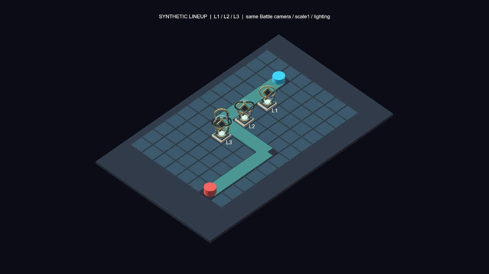

# ART.3c — GALE L1–L3 / #80

Третья production линейка: оригинальный подвешенный нефритовый талисман, открытые боковые ветровые дуги L2 и верхняя спираль L3. Один существующий FlameModelBinding отображает FLAME/TIDE/GALE, сохраняя serialized compatibility/fallback и authoritative TowerId/type/level. SourceSHA `9871af6`; [спецификация/regressions](../../ART3C_GALE_LEVELS.md), [source/provenance](../../../ArtSource/Blender/ART3/GALE/README.md).

[Singles L1](playmode/single-L1.png) / [L2](playmode/single-L2.png) / [L3](playmode/single-L3.png), [три семейства](playmode/three-family-comparison.png). Все эти model probes SYNTHETIC: назначены только presentation positions. Настоящий Play Mode, camera `(8,11,8)`/ortho8.5, scale1, production lighting; 1600×900. Без увеличения модели/камеры ради кадра.

[Front](playmode/occlusion-L3-front.png) / [side](playmode/occlusion-L3-side.png) / [behind](playmode/occlusion-L3-behind.png) и [dense12](playmode/occlusion-dense.png); полные front/side/behind каждого из трёх уровней находятся в playmode. Назначенные positions/HP.6 и скопированный реально полученный Gust snapshot честно подписаны SYNTHETIC. HP/status slots сохранены, Shade HP anchor принятого TIDE R2 не менялся. Эти probes отделены от natural public-command flow.

[Непрерывная Editor запись](editor-flow.mp4) и exact source PNG picks: [L1](playmode/video-L1.png), [L2](playmode/video-L2.png), [L3 доCombat](playmode/video-L3.png), [реальный Gust/HP/Inspect](playmode/video-Gust-inspect.png), [rollback](playmode/video-rollback.png), [Sell](playmode/video-sold.png). Byte-identical replay реально заработанного L1 checkpoint раскрывает origin/restore/readback; не называется новым fresh run. Frame/tick/time/PTS и hashes — reports. Sparse capture/encoder overhead не performance benchmark; generic beam остаётся до #47.

Точные gates, natural budget, команды, environment failures и ограничения — [validation](validation.md). [Независимое review](review.md), [manifest](manifest.json).

**Актуальный read-only clean-checkout verifier:** `PYTHONDONTWRITEBYTECODE=1 python3 Docs/review/ART.3c/verify_delivery.py` (Python3 + git + ffprobe). Проверяет source inventory/bytes/protected baseline, tracked artifacts, full positive suites, roundtrip и video provenance; не запускает Unity и не заменяет реальные runs. Исторические FLAME/TIDE R1/R2 evidence/verifiers не переписаны.

**Device Deferred to prerelease QA #53/#54/#55.** Новых iPhone proof/binaries/iOS export нет. Editor не является device/performance/touch/safe-area/background PASS. Финальные VFX47, карта45, враги46, UI48, родитель44 и STONE/STEAM/STORM отдельно. Без self-merge/release/TestFlight; owner approval и merge выполняет владелец.
