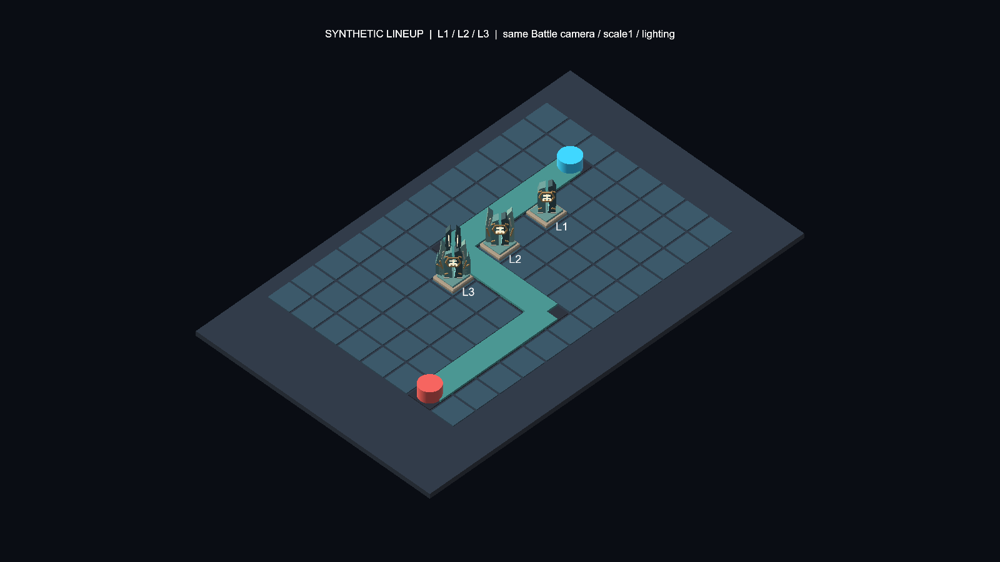

# ART.3d — STONE L1–L3 / #82

Четвёртая production линейка: оригинальный расколотый нефритовый монолит с крупной печатью, наклонные боковые плиты L2 и отдельные верхние зубцы/опоры L3. Прежний FlameModelBinding выбирает FLAME/TIDE/GALE/STONE по authoritative type+level, сохраняя GUID/serialized compatibility и одного fallback owner. TestedSource4c40545a91c46bd000d2335c31af132ba45ded62. [Спецификация/regressions](../../ART3D_STONE_LEVELS.md), [source/provenance](../../../ArtSource/Blender/ART3/STONE/README.md).

[Singles L1](playmode/single-L1.png) / [L2](playmode/single-L2.png) / [L3](playmode/single-L3.png), [четыре семейства](playmode/four-family-comparison.png). Model probes SYNTHETIC: назначены presentation positions, исходная Battle camera(8,11,8)/ortho8.5/scale1/production lighting. Actual Play Mode1600×900, без увеличения модели ради читаемости.

[Front](playmode/occlusion-L3-front.png) / [side](playmode/occlusion-L3-side.png) / [behind](playmode/occlusion-L3-behind.png) и [dense12](playmode/occlusion-dense.png); все9 front/side/behind для трёх уровней в playmode. Assigned positions/HP.6 и copied actual Crack snapshot честно подписаны synthetic. Production Shade HP anchor/status slots сохранены. [Catalog/preview/range без покупки](playmode/catalog-build-preview.png).

[Непрерывное Editor видео](editor-flow.mp4): [L1](playmode/video-L1.png), [L2](playmode/video-L2.png), [L3 доCombat](playmode/video-L3.png), [настоящие HP/Crack/Inspect](playmode/video-Crack-inspect.png), [rollback](playmode/video-rollback.png), [Sell](playmode/video-sold.png). Byte-identical replay действительно заработанного L1 через isolated file/menu Continue; это не новый fresh run. Затем public UI/API и advancing Combat. 198PNG frames/20.269s; timestamps/PTS/exact stage/frame/hashes в reports. Sparse capture/encoder overhead не performance benchmark. Generic beam — до #47.

[Фактические gates/бюджет/ограничения](validation.md), [точные команды и неуспешные попытки](commands.md), [независимое review](review.md), [manifest](manifest.json).

**Актуальный read-only clean-checkout verifier:** `PYTHONDONTWRITEBYTECODE=1 python3 Docs/review/ART.3d/verify_delivery.py` (Python3/git/ffprobe). Проверяет tested source inventory/bytes/protected baseline, tracked artifact hashes, positive full suites, actual roundtrip и video provenance. Не запускает Unity и не заменяет реальные runs. Старые verifiers/evidence не переписаны.

**Device Deferred to prerelease QA #53/#54/#55.** Новых iPhone/native binaries/iOS export нет. Editor не является device/performance/touch/safearea/background PASS. Parent44 и STEAM/STORM, карта45/враги46/VFX47/UI48, G2 и release/TestFlight отдельно. Без self-merge/release; приёмка и merge — владельцем после review.
