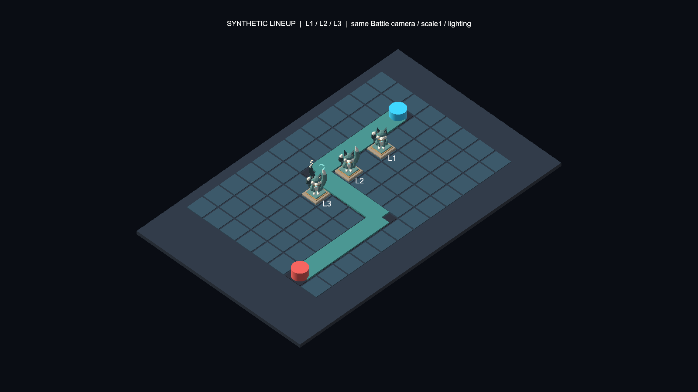

# ART.3e — STEAM L1–L3 / #84

Пятая production линейка: оригинальная нефритовая скульптура лисицы с острыми ушами, мордой, лапами и объёмными хвостами. L2 — второй поднятый хвост; L3 — третий хвост и открытые паровые завитки. Прежний FlameModelBinding выбирает FLAME/TIDE/GALE/STONE/STEAM по authoritative type+level; STORM/legacy/unknown/missing-level сохраняют fallback. [Контракт](../../ART3E_STEAM_LEVELS.md), [source/provenance](../../../ArtSource/Blender/ART3/STEAM/README.md).

[Singles L1](playmode/single-L1.png) / [L2](playmode/single-L2.png) / [L3](playmode/single-L3.png), [пять семейств](playmode/five-family-comparison.png). Все model probes — **SYNTHETIC**, actual Unity Play Mode1600×900; назначены presentation positions, camera(8,11,8)/ortho8.5/scale1, Mobile_RPAsset/qualityMobile, sun1.2. [Front](playmode/occlusion-L3-front.png), [side](playmode/occlusion-L3-side.png), [behind](playmode/occlusion-L3-behind.png), [dense12](playmode/occlusion-dense.png); все9ракурсов в playmode. Assigned HP и copied actual Wet snapshot явно подписаны; Wet не приписывается STEAM. Production Shade HP anchor/status slots не менялись. [Каталог/preview/range](playmode/catalog-build-preview.png): public selection без покупки, Gold3, цена110 и Insufficient Gold показаны честно.

[Непрерывное Editor видео](editor-flow.mp4): [L1](playmode/video-L1.png), [L2](playmode/video-L2.png), [L3 до Combat](playmode/video-L3.png), [настоящие HP/intrinsic Steam/Inspect](playmode/video-Intrinsic-Steam-inspect.png), [rollback](playmode/video-rollback.png), [Sell](playmode/video-sold.png). 610actual composited frames/85.787s elapsed; VFR610frames/85.639s source PTS span, без splice/изменения скорости. PNG picks побайтно скопированы из разных source frames по exact stage IDs, L3 не из rollback. Capture overhead/sparse frames — **не performance benchmark**.

Видео начинает byte-identical replay действительно заработанного L1 checkpoint в isolated file/menu store, **не новый fresh run**. Волны4–7: явно подписанный test clock30Hz с public Step/Cast, штатными presentation consumers/lifetimes и точными cast boundaries. Финальный Combat8 — production BattleSceneController.Update; read-only Inspect показывает primary HP15, отсутствие basic statuses, intrinsic Steam,2hits/102AppliedHpLoss. Это действующая механика catalog, не новый Burn/Wet или VFX. Generic beam/final effects отдельно #47.

Законная экономика: две FLAME(-3,-1)/(2,1); после3 открыть TIDE, STEAM(1,0) с Preparation4, после6 открыть GALE, L2 с Preparation7. После7 —50kills/14HP, две public продажи49+49 и Upgrade3 за220 дают investment495/Gold3. Полный бюджет498, без live Gold/HP/DTO/type/unlock edits. [Public commands/casts](inputs/earned.commands.json), [trace](reports/natural-trace.txt), [checkpoint L1](reports/natural-L1-checkpoint.json)/[L2](reports/natural-L2-checkpoint.json)/[L3](reports/natural-L3-checkpoint.json).

TestedSourceSHA: `9654133029902fb2541ee833d6ef80710755a5bb`. Media/product inputs заморожены в предыдущем source `2a0e05175b87a636b86db5136a7252a357241194`; финальный delta — только усиленный PlayMode assertion, связывающий primary/secondary одним event, без изменения игровых/визуальных inputs. [Gates/ограничения](validation.md), [команды и неуспешные попытки](commands.md), [независимое review](review.md), [manifest](manifest.json).

**Текущий read-only entry point:** `PYTHONDONTWRITEBYTECODE=1 python3 Docs/review/ART.3e/verify_delivery.py`. Исторические verifiers/evidence не изменены. Он требует clean tracked source/artifact state, полную SourceSHA/inventory/bytes и protected baseline, tracked artifact hashes, positive suites/roundtrip/video/earned-flow receipts. Неимпортируемые пользовательские root notes и существующий Scripts/__pycache__ сохраняются и не считаются игровыми inputs; untracked source/evidence в Assets/Packages/ProjectSettings/ArtSource/Docs/Scripts отклоняются. Это не скрывает tracked modifications: они блокируют gate.

[Текущие negative controls](reports/delivery-controls.json) выполняют реальные common inventory/blob/artifact validators на двух tiny files и clean Git commits во временной fixture — **без копии Unity project, нового worktree или клона**. Historical ART3d tamper matrix повторно не запускалась; текущий полный read-only entry point выполняется отдельно.

**Полный delivery gate — PASS после явного разрешения владельца.** В том же checkout временно использованы Git bytes ровно четырёх исходных файлов; backup вне проекта и восстановление original bytes 4/4 подтверждены [receipt](reports/delivery-approved.json). Verifier не менялся. После восстановления рабочий checkout снова содержит исходные изменения; обычный запуск на этом dirty состоянии обязан отказать. Полные Unity suites/captures в этом окне не повторялись.

**Device Deferred to prerelease QA #53/#54/#55.** iPhone/native binaries/iOS export/signing/TestFlight не запускались. Editor не device/performance/touch/safe-area/background PASS. Parent44 остаётся open: STORM отдельно; карта45/враги46/VFX47/UI48/G2/release не закрываются. Без self-merge/release, приёмка и merge — владельцем после review.
