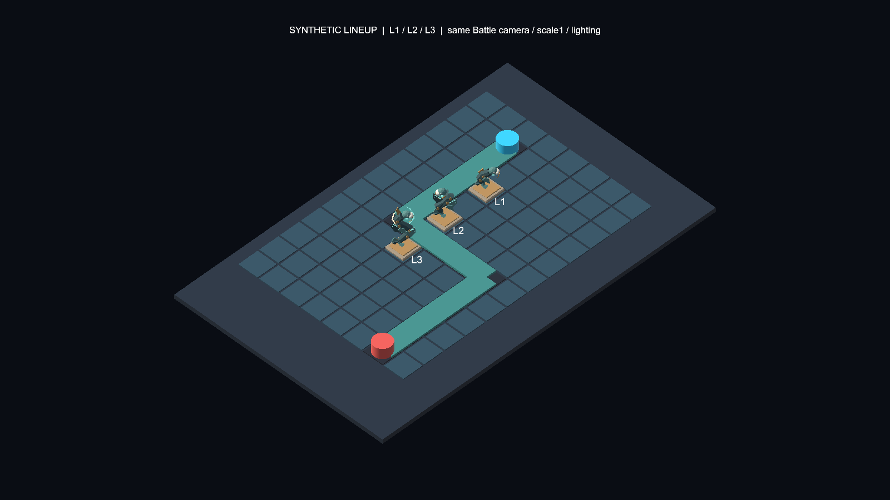
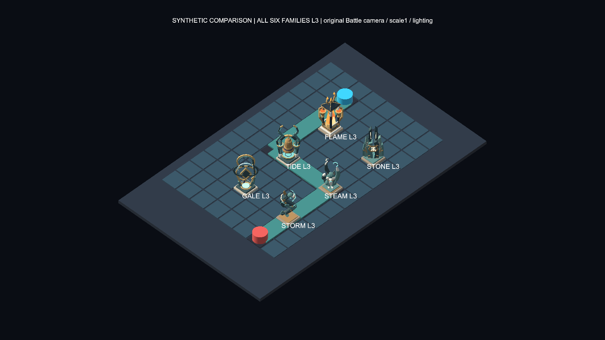
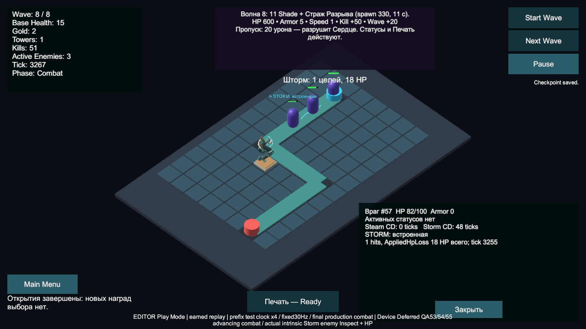

# ART.3f — STORM «Грозовой карп» / #86

Три оригинальные editable модели и шестое семейство в production Battle. [Спецификация](../../ART3F_STORM_LEVELS.md), [source/provenance](../../../ArtSource/Blender/ART3/STORM/README.md), [проверки и ограничения](validation.md), [точные команды](commands.md).

[Непрерывное Editor видео: earned L1→L2→L3, production Combat, intrinsic Inspect, Continue/rollback и Sell](editor-flow.mp4).254actual captured frames/35.49s, без склеек и изменения PTS. Префикс волн4–7 — явно подписанный test clock×4/fixed30Hz; Combat8 — production Update. Видео replay-ит byte-identical earned L1 checkpoint, не называется fresh NewGame. [Origin/readback](reports/video-checkpoint-origin.json), [PTS/picks/hashes](reports/video-proof.json).

[Single L1](playmode/single-L1.png) · [L2](playmode/single-L2.png) · [L3](playmode/single-L3.png). [Все6 L1](playmode/six-family-L1.png) · [L2](playmode/six-family-L2.png) · [L3](playmode/six-family-L3.png). [L1 behind](playmode/occlusion-L1-behind.png) · [L2 behind](playmode/occlusion-L2-behind.png) · [L3 behind](playmode/occlusion-L3-behind.png) · [dense12](playmode/occlusion-dense.png) · [catalog/preview](playmode/preview-selection.png).

Singles/comparison/front-side-behind/dense — явно SYNTHETIC presentation probes: позиции/HP назначены, Wet snapshot скопирован из отдельного TIDE fixture для проверки существующих status slots. Это не earned бой и не basic status STORM. Tower/enemy renderers ради кадра не отключаются. Production HP anchor2.0 и layout сохраняются.

**Device Deferred to prerelease QA #53/#54/#55.** Editor не подтверждает iPhone/readability/performance/touch/safe-area/background. Художественная приёмка владельцем, G2/final lightningVFX47/map/enemies/UI/release отдельно; без self-merge/release.
