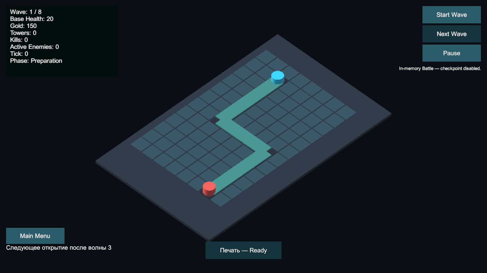
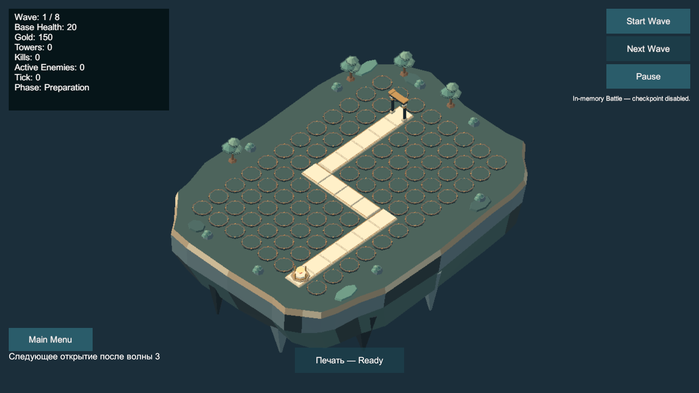
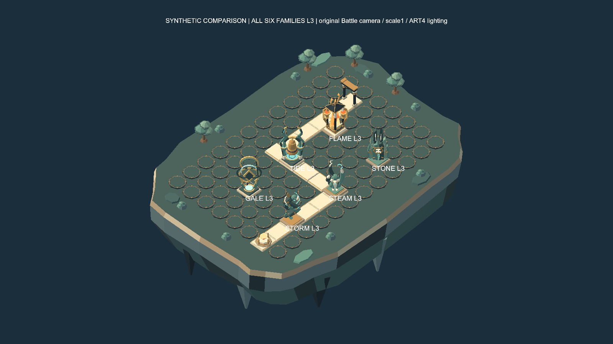
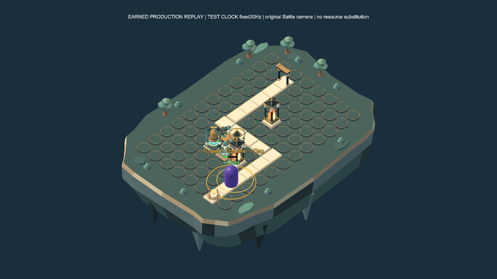

# ART.4 — production карта первой миссии / #45

**ART4-08 / P2 verifier revision:** mandatory delivery больше не требует личные TXT/pyc; exact4 rendering inputs и все строгие acceptance checks сохранены. [Режимы, воспроизводимые команды и новые проверки](p2-verifier/README.md), [повторное review](p2-verifier/review.md). Unity/media ниже — прежние runs, без нового Unity запуска для этой verifier-only правки.

[Спецификация/regressions](../../ART4_PRODUCTION_MAP.md) · [Фактические проверки и ограничения](validation.md) · [Команды/неуспешные попытки](commands.md) · [Source/provenance](../../../ArtSource/Blender/ART4/README.md).

| До: production graybox | После: production ART4 |
|---|---|
|  |  |

Одна Battle camera `(8,11,8)`, orthographic8.5,1600×900, Mobile/Metal, прежний масштаб. Намеренно изменены environment geometry, camera background, ambient и sun tint; точные значения в validation/actual-render-inputs, сравнение не называется lighting equivalence с ART3.

[Непрерывное Editor видео MainMenu→fresh NewGame→FLAME→preview/place→production Combat/ability→earned Upgrade→Combat2→file/menu Continue rollback→Sell](editor-flow.mp4).305разных player-loop frames,~31s, реальные PTS/1×/без cuts. Весь бой видео использует production Update, без test clock и подмены ресурсов. [PTS/hashes/exact-stage picks](reports/video-proof.json), [полный Grid/snapshot rollback](reports/video-safe-wire.txt).

[Все6 L1](playmode/six-family-L1.png) · [L2](playmode/six-family-L2.png) · [L3](playmode/six-family-L3.png) · [legacy fallback](playmode/fallback-unknown.png). Эти кадры synthetic: assigned positions, без покупки/экономики.18принятых моделей не изменены.

[Free build preview](playmode/input-build-preview.png) · [occupied/selection/range](playmode/input-occupied-range.png) · [blocked spawn/path rejection](playmode/input-blocked-rejected.png). Blocked клетка не создаёт preview/покупку; exact whole state остаётся прежним. Все96cells и boundary проверяет PlayMode regression.

[Враг за входом](playmode/decor-behind-entrance.png) · [за Сердцем](playmode/decor-behind-heart.png) · [за сосной](playmode/decor-behind-rim-pine.png) · [STORM L1 behind](playmode/occlusion-L1-behind.png) · [L2](playmode/occlusion-L2-behind.png) · [L3](playmode/occlusion-L3-behind.png) · [dense12](playmode/occlusion-dense.png). Это **synthetic occlusion probes**: assigned enemy positions/HP.6 и Wet snapshot из отдельного production TIDE fixture, не статус STORM. Существующие renderers не отключаются; bit64 stencil cue, HP/status anchors прежние. Pine probe намеренно вне playable grid, поскольку вся высокая растительность находится вне клеток/пути.

[Заработанный dense combat](playmode/earned-dense-combat.png) · [босс/Inspect](playmode/earned-boss-inspect.png) · [ability impact](playmode/earned-boss-ability-impact.png) · [Victory8](playmode/earned-victory8.png). Этот отдельный earned replay — **test clock, fixed30Hz/oneStep-per-frame/captureFramerate30**, без HP/gold/position/DTO edits. Final safe state совпадает с control; ability по boss115HP. Не выдаётся за fresh real-time playtest; production Update показан отдельным видео выше.

**Device Deferred to prerelease QA #53/#54/#55.** Editor/source scope передан на review; художественная приёмка/owner merge отдельно. #46enemies/#47VFX/#48UI/G2/release/TestFlight не закрываются. Собственный merge/release не выполняются.
