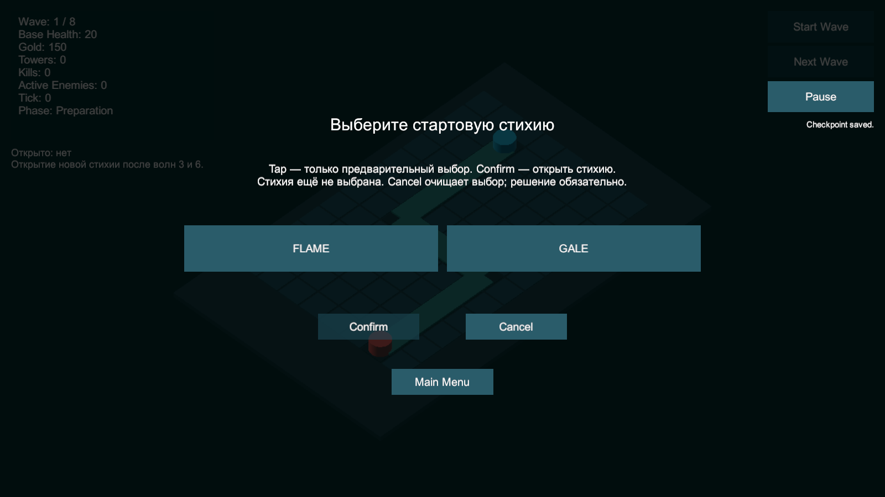
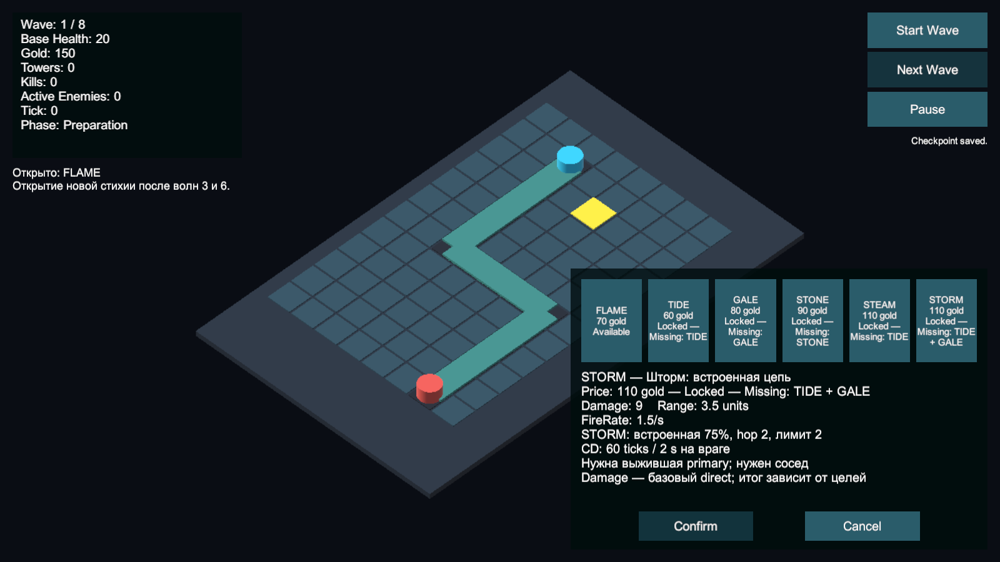
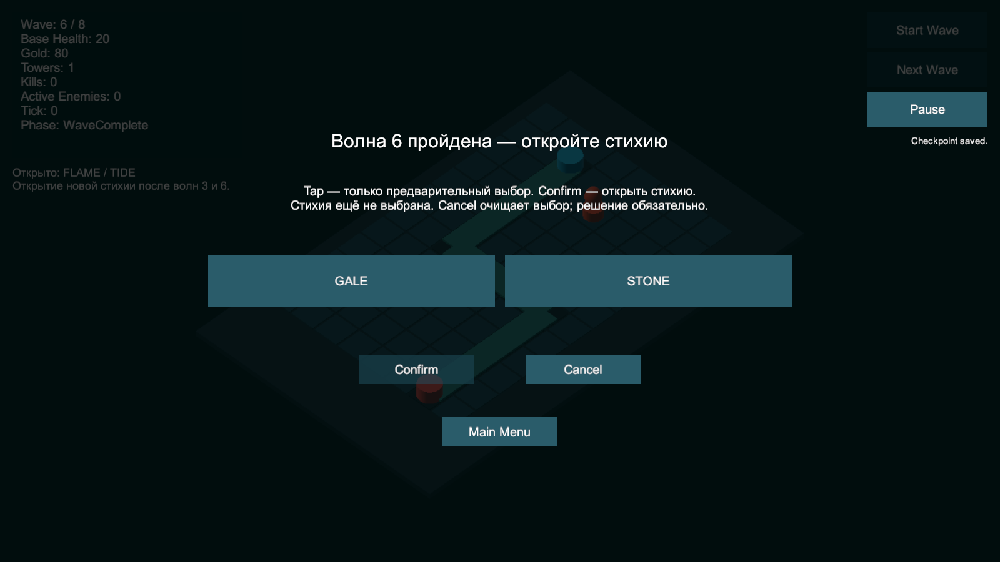
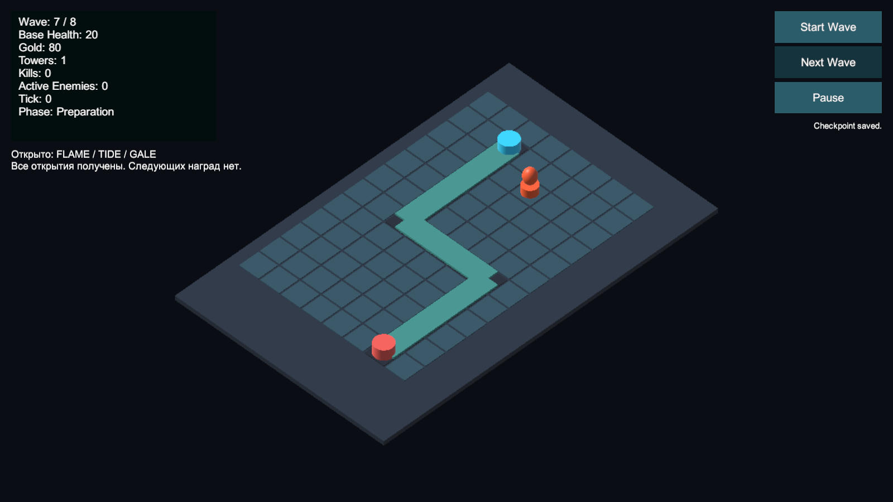

# P2.3d — native EightWave, выбор и Continue

Проверено 2026-11-17 (Asia/Novosibirsk). Изолированный worktree `p23d-native/Veilward`, ветка `codex/p2.3d-native-progression`, база **2a9da21de5f175cf8bf0fcd91064acc385be8d39** — main после merge PR #28. Проверенный source commit **0f83c4ff526c354fdc947e8bf95e262069780702**. Следующий evidence/docs commit runtime/tests не меняет.

Окружение: macOS **27.0.1 (26A434), arm64**, Unity **6000.3.28f1 (8f082d2fe476)**. Полные suites: Hub executable, **batchmode / -nographics / -buildTarget iOS**, Editor Mono. Это Editor tests, не iOS player/device run. Визуальная проверка: resident Editor, реальный Play Mode, uGUI, Pipeline `capture game_view --source screen`; кадры содержат Overlay UI. CLI 1.0.0; доступное обновление 1.0.1 не устанавливалось. Packages/Unity version сохранены.

## VERIFIED

- Public New Game native: mandatory FLAME/GALE без preselect, оба старта, Tap/Cancel только preview. Choose через scene controller, Domain остаётся последней проверкой. Повторный/stale Confirm не переносится на новый pending/восстановленный instance; success явно сохраняется даже при неизменном WaveComplete.
- Synthetic valid production boundaries3/6: канонический список только закрытых элементов; Confirm → WaveComplete, отдельный Next → Preparation4/7, отдельный Start. После второго открытия нет обещания следующей награды. Эти fixtures не доказывают естественное достижение волн.
- Все шесть карточек/цены видимы. Missing одна/две стихии и Gold различаются через Domain availability; locked STEAM/STORM имеют read-only детали, без tower/range world preview и покупки. Native parameterless placement не выбирает hidden test-tower.
- Общий pause/modal guard защищает direct APIs и реальные `Button.onClick.Invoke`: чужие Sell/Upgrade/inspector/placement/start/next не обходят modal. Choice допускает свой Confirm. Pause/background очищают preview, сохраняют pending, замораживают tick/resources. Resume не подтверждает выбор и сохраняет pointer suppression/no catch-up.
- Confirm save failure оставляет live success, durable bytes прежние, статус unsaved виден. Retry вызывает только SaveCurrentState. Start/Next сохраняют safe snapshot повторно после восстановления storage и переходят только после успеха. Combat Retry не меняет bytes/status и не пишет ложную ошибку.
- Настоящее MainMenu → New Game/Continue: pending/confirmed start и milestones, native army; legacy schema2 hybrid backup/army под production native config, label прежних правил, все шесть requirements открыты. Continue не хранит preview и не выдаёт повторные credits/Gold. Существующие schema/rollback/reaction controls сохранены.
- Builder/API сериализовал native settings и overlay. Validator проверяет refs, raycast blocking, safe-content parent, button target sizes и settings. Malformed/missing settings отклоняются: missing/wrong/duplicate start, missing/wrong/duplicate milestones и семь волн. Нет all-open production fallback.
- Исторические all-open assertions используют явно именованный internal factory/test-only compatibility fixture; combat timelines, economy, reactions, rollback и golden JSON сохранены. Domain/Infrastructure/schema3 не менялись.

## Команды и totals

Из корня worktree:

```sh
./Scripts/run-static-checks.sh
./Scripts/run-unity-tests.sh EditMode batch
./Scripts/run-unity-tests.sh PlayMode batch
git diff --check
```

Это обязательные suites из `run-edit-mode-tests.sh` / `run-play-mode-tests.sh`, с явно выбранным batch backend. Static self-tests используют fake runner в том же TestResults и удаляют старые reports: поэтому окончательные XML получены **после** static и сразу сохранены в `.xml.gz`. Предыдущие повторные зелёные прогоны не подменяют приложенные отчёты.

| Проверка | Результат |
|---|---|
| Static / version/packages/meta/GUID/asmdef | **38/38**, PASS |
| Полный EditMode | **734/734**, failed/inconclusive/skipped **0/0/0** |
| Полный PlayMode | **36/36**, failed/inconclusive/skipped **0/0/0** |
| Compile | Оба полных suites скомпилированы; в live QA compilationFailed=false |
| diff --check | PASS после удаления generated drift |
| Scope/config/GUID audit | PASS, [config-audit.json](config-audit.json) |

[EditMode.xml.gz](EditMode.xml.gz), [PlayMode.xml.gz](PlayMode.xml.gz), точные SHA256 исходных XML и gzip — [reports.json](reports.json); [static output](static-checks.txt), [Edit runner](edit-runner.txt), [Play runner](play-runner.txt). RED→GREEN для review fixes — [review.md](review.md). Основная автоматизация REG-173/184/185: `BattleElementChoicePresentationTests` (17 cases), `BattleElementUnlockPlayModeTests` (4 tests); compatibility/legacy UI — `ElementProgressionCheckpointPlayModeTests`, прежние catalog/pause/storage suites входят в полный запуск.

## Combat data и serialized audit

[config-audit.json](config-audit.json) сравнивает committed base/source, а не временные mutated suite assets. `TestWave.asset` byte-identical, SHA256 **4a1f02674410bc99b7862d5c9873ef6f5d60d56a43d88c0aeab5f4f5deffb6c3**. EightWave отличается только `scenarioContentId` и двумя добавленными serialized полями; после удаления только этой metadata bytes точно равны main. Новые arrays: FLAME/GALE = `0000000002000000`, milestones3/6 = `0300000006000000`. Все wave schedules, shared catalog/reactions, цены, HP, Gold и combat numbers прежние.

Существующие `.meta`/GUID, MainMenu scene bytes и обе scene GUID сохранены. MainMenu уже ссылался на EightWave по прежнему GUID; новый runtime controller использует тот же config. Battle сцена сгенерирована Unity builder/API, включая новые refs; object fileIDs сцены пересозданы builder, prefab/config asset GUID не заменялись. Новые scripts/tests имеют Unity-generated `.meta`. Автопересериализация URP/materials/Shade/MainMenu из builder/tests удалена в своей worktree. Нет новых dependencies/packages/аналитики/сети/credentials. Original checkout пользователя не изменялся.

## Реальное визуальное evidence

[Полные точные команды, C# fixtures, timestamps, frame/tick и capture results](qa-actions.json). Файлы eval: [New Game fixture](qa-newgame.cs.txt), [Game View viewport API](qa-viewport.cs.txt). Использованы только disposable slots `TestResults/P23dQA/slot`, не пользовательский persistentDataPath. В ходе обычного Combat после Start зафиксирован положительный tick progress между запросами; Play Mode не был заморожен на первом кадре.

Game View render targets: **1600×900 (16:9)**, **1200×900 (4:3)**, **1950×900 (19.5:9)**. Это реальные fixed-resolution Game View размеры, не только размер экспортированного PNG; `renderTarget` берётся из `PlayModeView.GetMainPlayModeViewTargetSize`. `Screen.width/height` в main-thread eval зависит от текущего Editor GUI и не используется как доказательство Game View размера. Кадры 01–12 сняты на 1600×900, 13–15 на 1200×900, 16 на 1950×900, остальные на 1600×900. В проверенных состояниях тексты/карточки/кнопки не перекрываются и не обрезаются; physical notch/gesture area этим не проверены.

| Состояние | Кадры | Тип setup |
|---|---|---|
| Старт, без preselect | [01](01-start.png), [4:3](14-start-4x3.png) | Настоящий New Game через меню |
| Locked STORM / STEAM после FLAME | [02](02-locked-storm.png), [03](03-locked-steam.png) | Настоящий Confirm, read-only catalog |
| Locked STEAM после GALE / wide STORM | [4:3](15-locked-steam-4x3.png), [19.5:9](16-locked-storm-wide.png) | Настоящий New Game/Confirm |
| Native army Continue | [04](04-continue-native-army.png), [меню](20-main-menu-native.png) | Typed FLAME build → настоящее меню |
| Pending3 / pending6 | [3](05-pending3-synthetic.png), [6](05-pending6-synthetic.png) | **SYNTHETIC** safe boundary на production config |
| Continue pending3 / pending6 | [3](06-continue-pending3-synthetic.png), [6](06-continue-pending6-synthetic.png) | **SYNTHETIC** checkpoint → настоящее меню |
| Pause / Resume, preview очищен | [Pause](07-pause.png), [Resume](08-resume.png) | **SYNTHETIC** pending3, реальные pause/resume |
| Continue confirmed3 / confirmed6 | [3](09-continue-confirmed3-synthetic.png), [6](09-continue-confirmed6-synthetic.png) | **SYNTHETIC** boundary + реальный Confirm/Continue |
| Preparation4 / Preparation7 | [4](10-preparation4-synthetic.png), [7](10-preparation7-synthetic.png) | **SYNTHETIC** boundary + реальный отдельный Next |
| Legacy mixed army, каталог | [11](11-continue-legacy-army-synthetic.png), [12](12-legacy-catalog-synthetic.png), [4:3](13-legacy-catalog-4x3-synthetic.png) | **SYNTHETIC** schema2, initial500 Gold для STEAM+STORM → настоящее Continue |
| Legacy label в меню/бою | [меню](21-main-menu-legacy-synthetic.png), [бой](22-continue-legacy-synthetic.png) | Тот же **SYNTHETIC** legacy save |
| Save failure / Retry success | [17](17-save-failure.png), [18](18-retry-saved.png) | Настоящий New Game; **injected I/O failure**, TempPath-directory |
| Native Combat | [19](19-native-combat.png) | Настоящие Confirm/build/Start и player loop |






## Console audit

[console-audit.json](console-audit.json) сохраняет raw entries и Editor groundTruth. До fault injection обычные New Game/Continue/native/legacy/UI: **0 errors / 0 warnings**, compilationFailed=false. Fault injection даёт ровно **1 ожидаемый Error** `Checkpoint save failed: Access ... .tmp is denied`, отражённый в UI; файл-директория затем удалён, Retry success. После очистки ожидаемой ошибки native Combat и заключительный legacy Continue: **0 errors / 0 warnings**, compilationFailed=false. Полный suite не подавляет неожиданные логи; ожидаемые I/O failures явно объявлены через LogAssert.Expect.

## NOT VERIFIED / BLOCKED

Natural native replay, достижимость/проходимость всех восьми волн, Steam/Storm production proc timelines и баланс — **P2.3e**, не закрыты synthetic milestones. Физический iPhone, реальный touch/multitouch, notch/safe area, background/force quit на iOS, frame time/allocations/thermal и on-device evidence не выполнялись. Hosted CI этого head не заявлен локальным PASS. Device QA/G2, ART approval, signing, TestFlight и release не закрываются. Новые зависимости/арт/баланс не добавлены. PR ожидает финального независимого review/approval; self-merge/release не выполняются.
