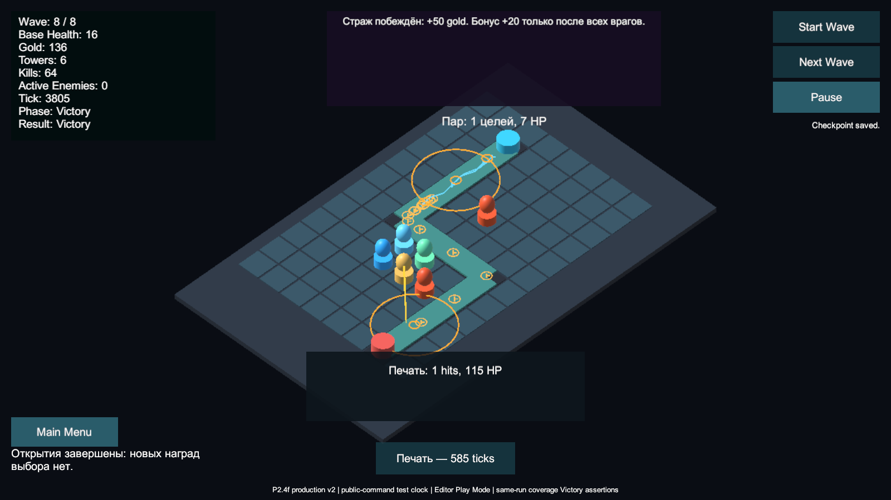
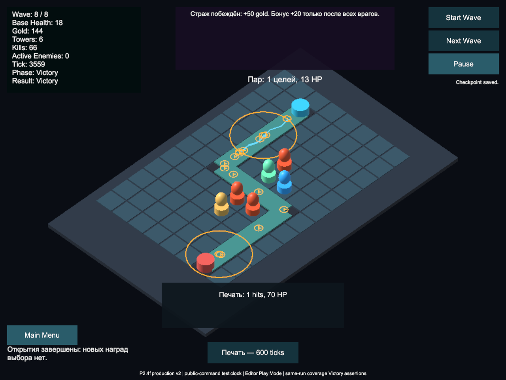

# P2.4f revision3 — winning production integration

Продолжен тот же PR70 от reviewed `a5faca3`. По делегации владельца выбран **boss600HP/armor5** для нового `eight-wave-ability-boss-v2`. V1/1000/5, native/all-open saves и 1301 прежний evidence файл сохранены. REG214 не ослаблен. [Спецификация](specification.md) · [HP-матрица, экономика и решение](decision.md).

## VERIFIED — один победный run каждого старта

| Route | Outcome | BaseHP / Gold / kills | Ability applied / kills | Boss kills | Applied: Steam pair/intrinsic, Storm pair/intrinsic |
|---|---|---|---|---|---|
|FLAME→TIDE→GALE|Victory8|16 / 136 / 64|1157 / 12|1|561 / 72 / 36 / 43|
|GALE→TIDE→FLAME|Victory8|18 / 144 / 66|1147 / 14|1|118 / 51 / 91 / 108|

Все показатели положительны в том же прохождении. [Inputs](inputs/) задают точные public commands, cast boundaries, centers и sequences. Каждый replay начинается с настоящих150Gold/20HP. Resources, IDs, progression и cooldown в live state/DTO не редактируются. [Natural reports](natural/) · [двойные traces](double/) · [per-wave CSV](per-wave.csv).

## VERIFIED — полная matrix на winning inputs

- Два независимых full trace каждого старта совпадают побайтно: каждый tick/command, State/Grid/army/IDs/nextAttack/progression/ability, enemies/statuses/timestamps и четыре event streams со всеми attribution/sequence/position/damage/overkill полями. Events записаны до consume/clear. Проверены HP по EnemyId, actual costs/refunds и единственные rewards/bonuses. Closed/stale/double/invalid probes сохраняют whole state/events.
- Whole file-continued trace равен uninterrupted control. Store/factory/Restore используются на safe boundaries: initial pending/confirmed, pending/confirmed3/6, Preparation7/8. Repeated Load/Continue не пишут bytes. По13 save faults/start:3Confirm +8completion +Next7/8; restart загружает прежний файл, Retrytwice меняет только persistence. Failed save оставляет live success; Start/Next требуют durable safe snapshot.
- Combat7/8 обоих стартов прерываются после accepted ability kill и positive reaction, оставаясь Combat с живыми enemies и непустыми streams. Rejected restore сохраняет dirty state/events. Dirty и fresh file restore возвращают полный pre-Start Preparation, включая HP/Gold/Kills/towers/IDs/nextAttack/progression/cooldown/sequence. Два discarded prefix совпадают; весь continued trace равен control. Fresh instance получает настоящий LoadReadOnly.
- Использованы настоящие MainMenu/Session/CheckpointController/Buttons, placement/sell controllers, world dispatcher и ability lease. Double Confirm даёт один cast. Corrupt/cross-version rejection сохраняет queued intent/owner/lease. Pause/Resume замораживают state/cooldown. Continue чистит enemies/status/events, owners/preview/intents/inspector/selection, beams, reaction/ability VFX и summary. UI проверяет Confirm3 failure/restart, Confirm6 Retry, Next7/8 Retry и completion7/8 failure/Retrytwice на победных маршрутах. Terminal Continue выключен.
- Requested v2 принимает v1/native/all-open через matching factory с сохранением ID при Save. Обратный v2→requested v1 запрещён. Exact-ID dirty restore отвергает оба направления до mutation. Четыре режима проверены во всех12 ordered mixed-slot парах с no-write Load, previous-primary backup и corrupt fallback. Validator закрепляет production v2 path и ID в MainMenu/Battle; valid v1 payload по v2 path покрыт RED→GREEN regression.

[File matrix и faults](files/) · [version slot audit](experiments/version-slots.txt) · [raw EditMode XML](reports/EditMode.xml.gz) · [raw PlayMode XML](reports/PlayMode.xml.gz).

## Balance и timing

Первая матрица:16 full replays, четыре revision2 scripts ×HP1000/700/650/600. Только600 даёт qualifying Victory обоих стартов; выигрывают три из четырёх histories. Контроль1000 полностью совпадает с прежними reports/raw hashes. Далее выполнены16 timing probes,4 no-cast controls,16+8 ограниченных cast-вариантов,2 final route generation,16 winning timing и8 center probes —86 Domain full outcomes плюс отдельный historical v1 leak. Полные suites повторяют их как фиксированные regressions; широкого поиска100000 заново нет.

Исходные FTG/GTF при600 выигрывают при всех сдвигах boss cast на±15/30ticks. Для Combat8 rollback построены маршруты с ранним ability kill и вторым boss cast. Их matched запас —38/26ticks (1.27/0.87s), время жизни босса —15.13/15.53s. Ранняя попытка второго cast попадает в cooldown и пропускается; GALE+30ticks проигрывает. Эти исходы сохранены. Все8 center probes±0.5 по отдельным осям выигрывают. Это не гарантия нечувствительности любой игры к timing. [Все исходы, экономика и timing](balance-analysis.json) · [анализ и выбор600](decision.md).

Отдельные Stone controls на v2 дают Victory/base10/14 и убивают босса через6.7/9s после spawn. Они не заменяют REG214. Новый legal Sell-all/no-cast8 control достигает Preparation8 сHP16;11Shade уменьшаютHP до5, boss leak20 даёт Defeat без boss reward/bonus. Исторический v1 no-cast control сохраняет Defeat/boss276HP. [V2 controls](controls/) · [v1 leak](experiments/historical-leak.json).

## Полные gates

Tested source: `f9312ea3bbcc47023f8ac7462c2d942d9a17e0a7`. Unity6000.3.28f1 (`8f082d2fe476`), CLI1.0.1 latest, macOS/arm64, targetiOS. [Окружение](environment.json) · [точные команды](commands.md).

| Gate | Результат |
|---|---|
|Static|38/38 + version/packages/meta/GUID/asmdef PASS|
|EditMode|1100/1100 PASS|
|PlayMode|60/60 PASS|
|Graphical|5/5 PASS,114PNG|
|Failed/skipped/inconclusive в финальных suites|0/0/0|
|Compile/builder/reproducibility/saved references|полные suites PASS|
|Historical bytes|1301/1301 unchanged; старые verifiers PASS в detached a5faca3|
|Packages/Unity version/shared catalogs/v1 config|unchanged|
|Branch diff --check|PASS|

[Raw XML/logs](reports/), [source SHA256](source-sha256.json), [artifact manifest](manifest.json), [XML audit](report-audit.json), [historical byte audit](historical-audit.json). Gzip traces проверяются по SHA256 и размеру распакованных bytes.

Красные reports сохранены: revision2 остаётся1075/1077 с двумя mandatory REG214 FAIL на1000/5; v2 REG214 проходит с прежними критериями. Промежуточный focused21/23 не падал на REG214: прежний no-cast control при600 выиграл, а новые definition objects требовали сравнения значений вместо ссылок. Отдельный validator RED0/1 исправлен guard. Ранние graphical XML сохранены как промежуточные; финальные кадры пересняты после UI completion faults и исправления version label.

```bash
python3 Docs/review/P2.4f/revision-3/verify-evidence.py
git diff --check a5faca3
```

## Реальные кадры и Console

[82 winning matrix frames](play/) и [32 Stone/leak frames](stone-play/), wide1600×900 и narrow1280×960. ScreenCapture из настоящего Editor PlayMode; telemetry фиксирует advancing frameCount. Console:0 unexpected errors,14 expected injected IO errors,64 учтённых memoryless depth load/store warnings. [Console/frame/dimensions audit](console-audit.json).

Battle.Update отключён для ускоренного public-command test clock. Настоящие controllers/LateUpdate/UI/rendering сохраняются; это не realtime performance proof. Insets44px в Stone UI обозначены как injected.




Независимое source/evidence review: [review.md](review.md). Выявленный P2 validator gap исправлен отдельной regression.

## NOT VERIFIED / отдельные gates

Physical iPhone, IL2CPP/Metal player, touch/background/force quit/performance, human G2/ART, #52/#56/release/TestFlight и hosted Unity CI этим не подтверждены. Projects field не изменялся и не подтверждён. Баланс выбран в делегированном scope; повторное утверждение чисел не ожидается. #40 остаётся open до фактического merge. Self-merge/release/TestFlight не выполняются.
